<p align="center"></p>

<p align="center"><strong>The Open-source Super Game Agent</strong><br>Everyone can build games that make money.</p>

<p align="center">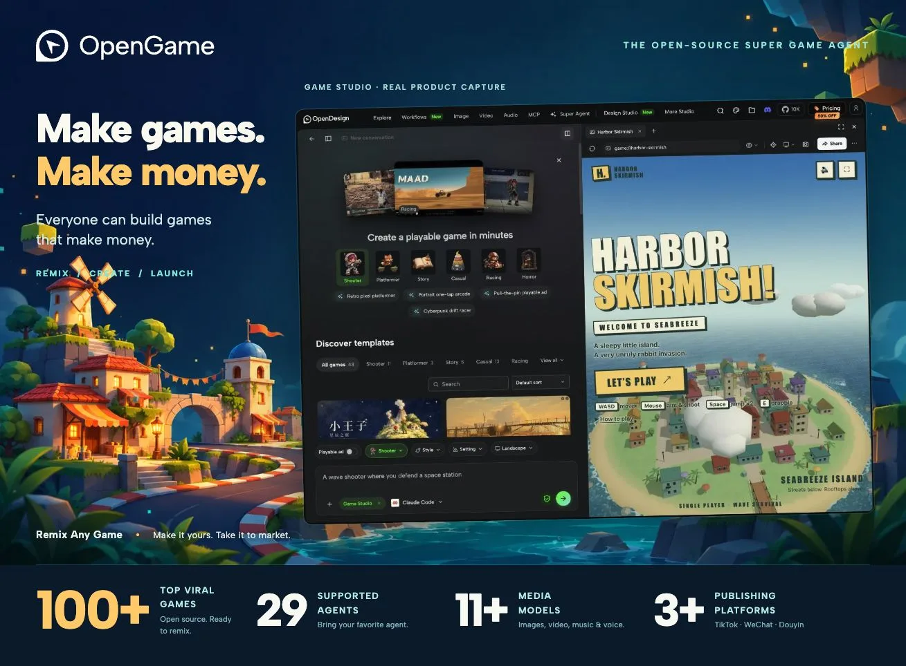</p>

<p align="center">
  <a href="https://github.com/OpenDesignHQ/opengame"></a>
  <a href="package.json"></a>
  <a href="LICENSE"></a>
  <a href="https://github.com/OpenDesignHQ"></a>
</p>

<p align="center">
  <a href="https://github.com/OpenDesignHQ/opengame"></a>
  <a href="https://go.open-design.ai/?utm_source=github&amp;utm_medium=referral&amp;utm_campaign=opengame&amp;utm_content=readme_en"></a>
  <a href="https://discord.com/invite/M7NnHS9gNa"></a>
  <a href="https://applink.feishu.cn/client/chat/chatter/add_by_link?link_token=b6cs46dc-acb2-48ed-941d-c45642ead841"></a>
  <a href="https://x.com/OpenDesignHQ"></a>
  <a href="https://x.com/OpenDesignDevs"></a>
  <a href="https://www.youtube.com/channel/UChtshixMhvtgBWzoD9R_Qfg"></a>
</p>

<p align="center"><a href="#quick-start">Install</a> · <a href="#agent-wall">Agents</a> · <a href="#showcase">Games &amp; remixes</a> · <a href="#features">Why OpenGame</a> · <a href="#technical-guide">Setup &amp; architecture</a> · <a href="#community">Community</a></p>

<div align="center">

**English** · [简体中文](docs/README.zh-CN.md) · [日本語](docs/README.ja.md)

</div>

# OpenGame

OpenGame is **The Open-source Super Game Agent**. Start with an idea or a game you love. Let your agent turn the mechanics, world and rewards into a playable game of your own, then keep improving it for real players.

**Our mission: everyone can build games that make money.**

You bring the idea and taste. OpenGame brings the creation workflow, remixable source, art and sound tools, playable previews and a path from first build to launch.

- 🎮 **Remix Any Game** Start a remix in one click. Turn a reference or bundled game's core loop into your own theme, rules and experience.
- 🌍 **Publish to TikTok, WeChat & Douyin** Publish to TikTok, WeChat, Douyin and more. Turn one game idea into a business that reaches players across platforms.
- 🔥 **100+ TOP Viral Games** Our first open-source release of 100+ top viral games, bringing commercially successful game formats into a collection you can study, run and remix.
- 🔑 **29 agents. Your choice.** Bring your agent and model keys; keep your source and workflow. [Choose an agent](#choose-agent).
- 🎨 **11+ media models.** Create the art, music and voice your game needs. [Explore models](#model-wall).

**Remix → Create → Play-test → Launch → Earn.** Start with the fun. Make it yours. Build a reason for players to return.

<a id="quick-start"></a>

## 🚀 Start playing. Then start creating.

### Run from source

Use Git, npm and **Node.js 26.11.1**, the version pinned in CI. The declared runtime minimum is 22.18.0.

```sh
git -c filter.lfs.process= -c filter.lfs.smudge= -c filter.lfs.required=false clone --depth 1 --single-branch --branch main https://github.com/OpenDesignHQ/opengame.git
cd opengame
npm ci
npm run build:studio
```

Start with a separate workspace on macOS / Linux:

```sh
MOTION_DATA_DIR="$HOME/.opengame/workspace" npm start
```

Open the startup result's `previewUrl` and choose **Game Studio** (`/game`). You can browse and play bundled games before connecting an agent. To create or remix, select your agent and describe what you want to change. In the integrated Studio, creation can hand the task directly to the selected agent.

[Windows instructions, manual MCP configuration and troubleshooting →](docs/opengame-setup.md)

### Your first remix

1. **Find the fun.** Open a game and try its controls. Choose one mechanic to keep.
2. **Make a copy.** Use **Remix** on a bundled game to create your own editable draft.
3. **Change one thing well.** Give the agent a concrete theme, rule or level change.
4. **Play it again.** Check the result, refine the feel and share when it is ready.

Try this with a connected agent:

```text
Remix Drift Dash into a moon buggy race. Keep the portrait controls,
replace the city with a lunar base, and add a boost that recharges
when I drift. Validate and play-test the result, then open it for me.
Use bundled or procedural assets for the first version.
```

<a id="agent-wall"></a>

**29 local agents** · [Choose your agent](#choose-agent)

<p align="center"><a href="#choose-agent"><picture><source media="(max-width: 600px)" srcset="docs/readme/opengame/agents.mobile.webp">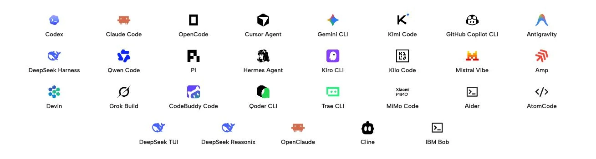</picture></a></p>

<a id="showcase"></a>

## 🔥 100+ TOP Viral Games. Open source. Yours to remix.

For the first time, we are opening up our **100+ TOP Viral Games** collection: a starting point for creators who want to learn from commercially successful game formats and build their own. Explore the mechanics, run the source, change the world and create a version for your audience.


These six examples are **real captures from games bundled in this repository**. Each image links to editable source. Run Game Studio locally to play and remix them.

<table><tr>
<td width="50%" valign="top">
<a href="templates/games/harbor-skirmish">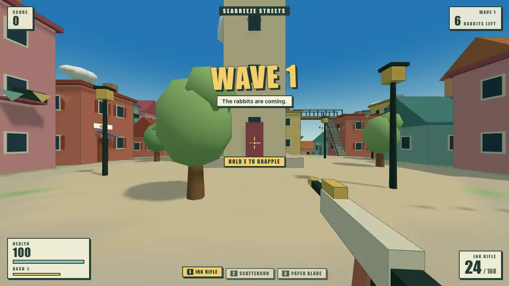</a><br>
<strong>Harbor Skirmish</strong><br>
<sub>3D action</sub><br>
Run, jump, dash and grapple across a seaside island. Remix the world, enemies and weapons.<br>
<a href="templates/games/harbor-skirmish">View source</a>
</td>
<td width="50%" valign="top">
<a href="templates/games/rooftop-roast">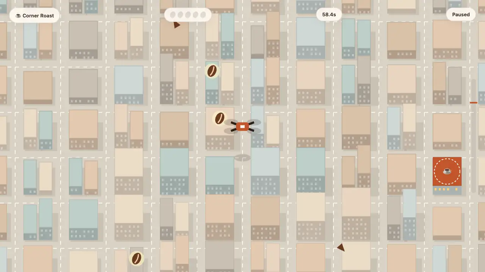</a><br>
<strong>Rooftop Roast</strong><br>
<sub>Brand mini-game</sub><br>
Pilot a tiny drone, collect coffee beans and land on the café roof. Make the shop, offer and reward your own.<br>
<a href="templates/games/rooftop-roast">View source</a>
</td>
</tr>
</table>

<table>
<tr>
<td width="50%" valign="top">
<a href="templates/games/drift-dash">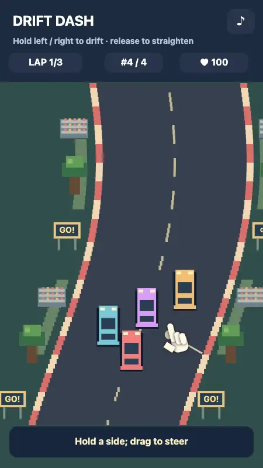</a><br>
<strong>Drift Dash</strong><br>
<sub>Arcade racing</sub><br>
Race three AI rivals through a three-lap circuit. Change the handling, track and win condition.<br>
<a href="templates/games/drift-dash">View source</a>
</td>
<td width="50%" valign="top">
<a href="templates/games/pin-rescue">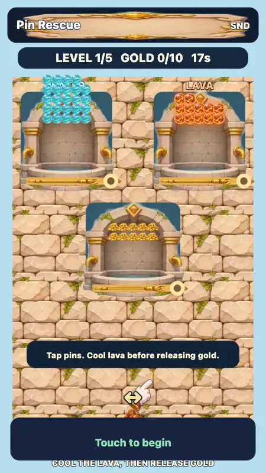</a><br>
<strong>Pin Rescue</strong><br>
<sub>Puzzle</sub><br>
Pull pins to combine water and lava, then release the gold. Build a new sequence of puzzles.<br>
<a href="templates/games/pin-rescue">View source</a>
</td>
</tr>
</table>

<table>
<tr>
<td width="50%" valign="top">
<a href="templates/games/sort-stack">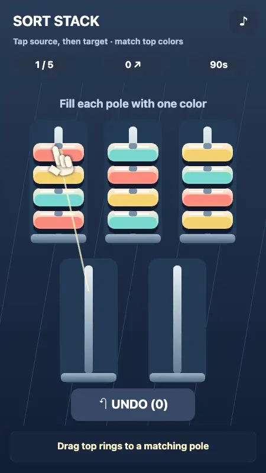</a><br>
<strong>Sort Stack</strong><br>
<sub>Casual puzzle</sub><br>
Move matching rings between poles. Remix the colors, level layouts and time pressure.<br>
<a href="templates/games/sort-stack">View source</a>
</td>
<td width="50%" valign="top">
<a href="templates/games/tilt-temple">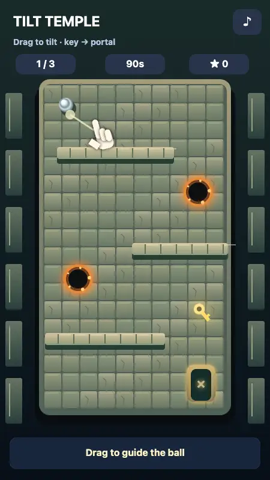</a><br>
<strong>Tilt Temple</strong><br>
<sub>Physics challenge</sub><br>
Tilt a maze, collect a key and reach the portal. Rework its paths, hazards and atmosphere.<br>
<a href="templates/games/tilt-temple">View source</a>
</td>
</tr>
</table>

### Explore the whole collection

The source examples below cover six genres. Use them to explore a core loop, visual treatment or input scheme, then develop your own version. This checkout contains **26 bundled examples** from the broader collection.

| Genre | Bundled games |
| --- | --- |
| Shooters · 5 | [Comet Guard](templates/games/comet-guard) · [Harbor Skirmish](templates/games/harbor-skirmish) · [Lane Turret](templates/games/lane-turret) · [Periscope Depth](templates/games/periscope-depth) · [Starlight Bastion](templates/games/starlight-bastion) |
| Platformers · 2 | [Lantern Hop](templates/games/lantern-hop) · [Skyline Courier](templates/games/skyline-courier) |
| Stories · 2 | [Lighthouse Log](templates/games/lighthouse-log) · [Night Train Letters](templates/games/night-train) |
| Casual & puzzles · 11 | [Castle Crush](templates/games/castle-crush) · [Gate Legion](templates/games/gate-legion) · [Glyph Garden](templates/games/glyph-garden) · [Jingyang Ridge](templates/games/jingyang-ridge) · [Merge Bakery](templates/games/merge-bakery) · [Pin Rescue](templates/games/pin-rescue) · [Rooftop Roast](templates/games/rooftop-roast) · [Slime Swell](templates/games/slime-swell) · [Sort Stack](templates/games/sort-stack) · [Stack the Moon](templates/games/stack-the-moon) · [Tilt Temple](templates/games/tilt-temple) |
| Racing · 4 | [Drift Dash](templates/games/drift-dash) · [Neon Drift](templates/games/neon-drift) · [Sky Runner](templates/games/sky-runner) · [Tidebreaker](templates/games/tidebreaker) |
| Horror · 2 | [Hollow Signal](templates/games/hollow-signal) · [Last Light](templates/games/last-light) |

Studio also displays community references with their original author links. Those references are separate from the bundled source collection. Remixing an external reference starts a new original game brief; it does not import the creator's code or assets.

<a id="features"></a>

## ✨ Why OpenGame

### 1. The Open-source Super Game Agent

<p>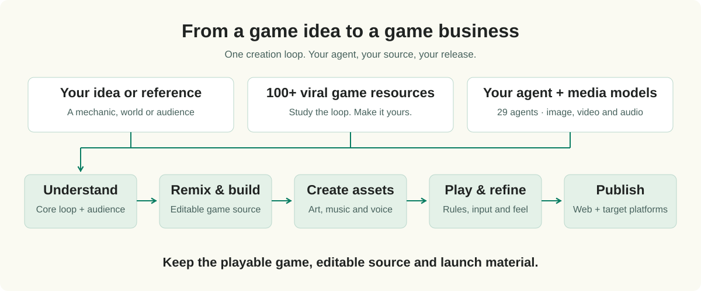</p>

#### Create, play and improve in Game Studio

Describe a game on the left and explore its result in the **Artifact Viewer**. Switch between preview and source, reopen an existing game, or continue the next iteration with your agent. You can look at what is being built while deciding what should change next.

<p>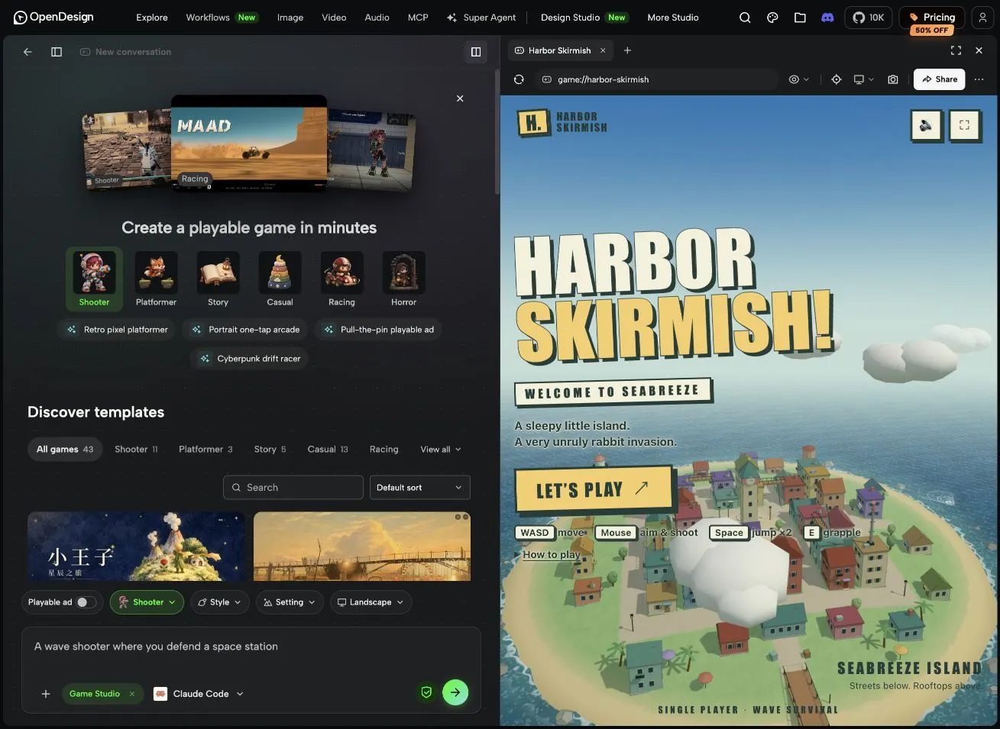</p>

*Actual source-build interface: Game Studio and Harbor Skirmish in the same workspace.*

| In the workspace | What it helps you do |
| --- | --- |
| Genre, style and setting controls | Give the agent a useful starting direction before writing a detailed prompt |
| Template discovery and search | Find a working example by gameplay or visual idea |
| Playable preview | Try the game instead of judging it only from a cover |
| Preview / Code modes | Inspect the HTML source behind the current game |
| Landscape / portrait orientation | Design around the target screen and control scheme |
| Workspace assets and owned games | Return to your own drafts and keep developing them |
| Sharing and trailer tools | Prepare a playable link or a gameplay video when the prerequisites are ready |

The creative cycle is simple: **describe → build → play → refine**. A useful next instruction is specific: “the first jump is too hard,” “make the reward clearer,” or “give the player a reason to take the risky route.”

#### From a brief to a playable game

Good games need a readable objective, responsive controls and a reason to continue. The game workflow asks the agent to plan the experience before implementing it: who is playing, what they do, how they win, what makes them fail and how the difficulty develops.

<p>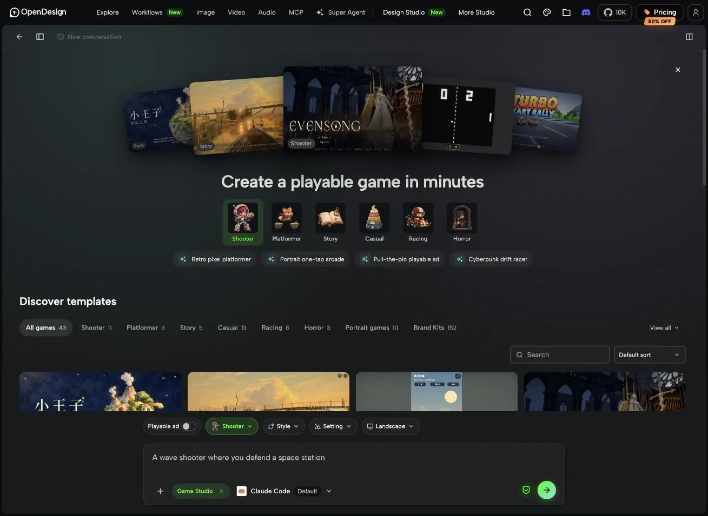</p>

Choose from **shooter, platformer, story, casual, racing and horror**; explore **pixel, minimal, ASCII, voxel, anime or 3D** treatments; set the world in **medieval, cyberpunk, retro, modern, space or fantasy** surroundings. These controls guide the brief. The resulting game still needs implementation and review.

| Step | The work | What you can review |
| --- | --- | --- |
| Brief | Core action, audience, device, session length and success condition | A focused description of the experience |
| Plan | Controls, camera, rules, difficulty and visual formula | The game plan and art direction |
| Assets | Reuse, author or generate the required visuals and audio | An asset list with sources, licenses and costs |
| Build | Implement mechanics, feedback, menus and restart behavior | Real game files and a playable preview |
| Verify | Validate resources, simulate rules and exercise controls | Actual results, screenshots and remaining gaps |
| Deliver | Capture a cover, save metadata and prepare sharing | An owned game you can revisit and improve |

A brief you can use:

```text
Create a cozy rooftop delivery game for desktop browsers.
The player has 90 seconds to deliver three parcels, with a double jump
and a clearly marked landing zone. Use a warm sunset palette and chunky
3D shapes. Include an opening instruction, a visible timer, win/loss
states, pause and restart. Make the first delivery easy to learn.
Plan the game, implement it, and test the complete loop.
```

<a id="choose-agent"></a>

### 2. Free and open source. Bring your agent and keys.

**BYOA — Bring Your Own Agent. BYOK — Bring Your Own Keys.** Choose your local agent and connect your own model providers. Your game source stays in your workspace.

<p align="center">


</p>

**29 local agents, one game workflow.** [See the supported agents above](#agent-wall) or inspect the [current client registry](shared/local-agents.ts).

OpenGame connects game tools, source files and a visible workspace to your coding agent. Use the integrated local-agent entry or connect a client that supports **local stdio MCP**. The source includes adapters for the clients above; installation, authentication and model support depend on each client. A badge does not mean every client/model combination has been tested.

| You bring | OpenGame provides |
| --- | --- |
| An installed, authenticated coding agent | Game creation, file editing, preview and verification tools |
| A game idea, reference or starting template | A brief, reusable workflow instructions and an editable project |
| Your own art, music or configured media provider | Asset discovery, generation jobs and a shared asset library |
| Creative judgment and play-testing | Repeatable checks, visible results and source you can keep |

The open-source application does not include model credits. Your agent subscription, media-provider usage and optional hosting have their own requirements. You can start with bundled assets and procedural graphics before generating new media.

### 3. 100+ TOP Viral Games. Remix Any Game.

**Bring the game. Make your version.** A mechanic, a reference link or a playable starting point can become the brief for a new game. Ask the agent to identify the core loop, change the setting, design a fresh progression and build a playable version.

For bundled games, **Remix** copies the source into an owned draft. For community references, the same action starts a new original-game brief from the catalog description, genre and style. One click starts the workflow; the agent then implements and play-tests the result. An external game's source and assets are not automatically imported.

<p>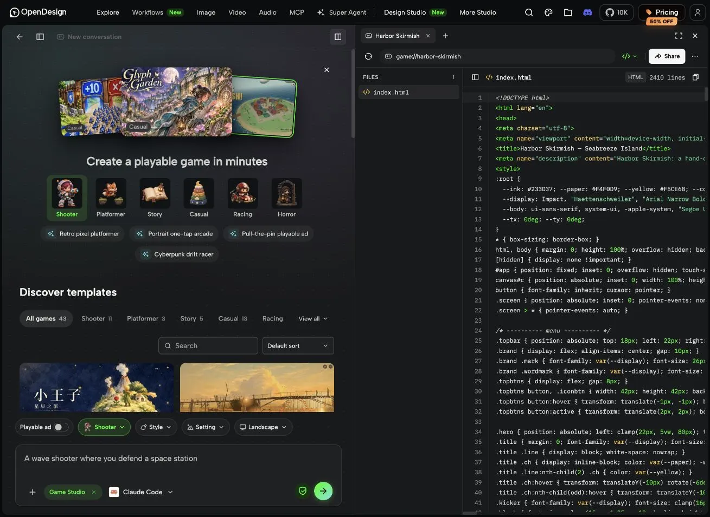</p>

*Preview and source are views of the same game. The screenshot preserves the interface's original labels.*

| Starting point | A meaningful remix |
| --- | --- |
| Harbor Skirmish | Turn wave survival into a timed rescue mission with fewer enemies and clear objectives |
| Drift Dash | Reward careful drifting with a rechargeable boost and redesign the circuit |
| Pin Rescue | Add a new puzzle sequence where water must cool lava before gold can fall |
| Sort Stack | Build a relaxed learning mode with color labels, undo and increasingly constrained layouts |
| Rooftop Roast | Change the shop, collection objective and end reward for a brand campaign |
| Tilt Temple | Add alternate routes, checkpoints and a different risk/reward balance |

These are suggested briefs, not claims that those variations ship as finished games. Start with a small change, play it and expand once the loop feels right.

The workflow keeps useful context in ordinary project documents: `design/plan.md` for the experience and acceptance conditions, `design/assets.csv` for the asset inventory, and `design/verification.md` for actual checks and gaps. These files make it easier to continue a game later or hand it to another agent.

#### Project context that travels with your game

<p>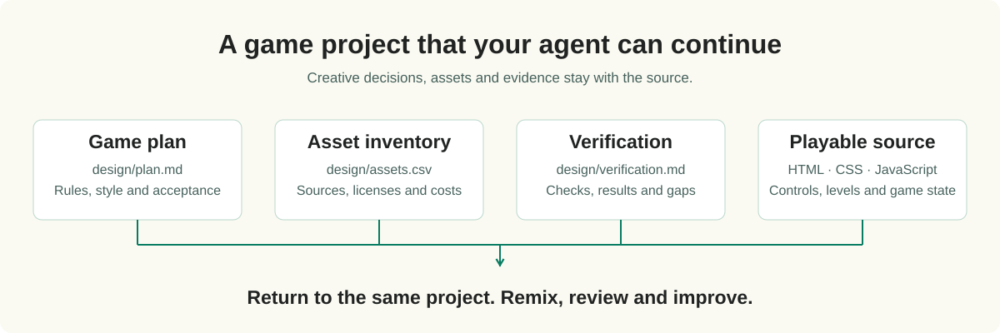</p>

### 4. Images, video, music and voice for your game

<a id="model-wall"></a>

**11+ media models** for images, video, music and voice. Use the models available through your connected providers.

<p align="center">


</p>

Bring existing assets or use configured media providers for character art, backgrounds, textures, music, speech and video. The agent discovers the live model catalog, chooses a suitable capability and brings completed assets into the game. Keep art direction consistent across the whole experience.

| Creative need | Current route | Example model families in the workflow |
| --- | --- | --- |
| Character art, environments, textures, covers | Image generation or supplied images | GPT Image, Seedream |
| Music and atmosphere | Music generation or supplied audio | ElevenLabs Music |
| Narration and character lines | Text-to-speech or supplied recordings | ElevenLabs, BytePlus TTS |
| Cinematic clips or launch material | Video generation | Wan, Seedance |
| Immediate gameplay sound effects | Code-authored Web Audio | Local synthesis, no media-model call |
| 3D characters and props | Bundled CC0 GLBs or procedural Three.js geometry | Existing 3D assets and code |

Model IDs and availability come from the configured environment; the table describes asset roles, not a promise that every account has every model. Dedicated image-to-3D, rigging and animation generation are not part of the currently listed game-model capabilities.

For a first playable version, reuse art and keep the scope small. Once the mechanics work, specify the assets worth generating. The asset manifest records each source, license and approved cost, so a polished game remains understandable and maintainable.

<a id="technical-guide"></a>

## 🛠️ Setup & technical architecture

### This source snapshot

The product offering includes the 100+ game collection and cross-platform publishing described above. The checkout used for this guide contains 26 bundled source games; the commands and tool names below describe this checkout. Its game publication tool lists a game locally, and public web sharing uses the separate hosting workflow. Platform release instructions belong to the corresponding product integration.

### Source checkout + MCP

The [setup guide](docs/opengame-setup.md) covers installation, a separate data directory, Windows and manual client configuration. **Studio and MCP must use the same absolute `MOTION_DATA_DIR`** so the agent edits the games visible in your workspace.

<details>
<summary><strong>Manual stdio MCP configuration</strong></summary>

Use this with clients that accept an `mcpServers` object. Replace all paths with absolute paths to your Node executable, this checkout and the workspace. Use your client's native configuration format where it differs.

```json
{
  "mcpServers": {
    "opengame": {
      "command": "/absolute/path/to/node",
      "args": [
        "--experimental-strip-types",
        "/absolute/path/to/opengame/mcp.ts"
      ],
      "env": {
        "MOTION_DATA_DIR": "/absolute/path/to/.opengame/workspace"
      }
    }
  }
}
```

Reload tool discovery and ask the agent to read the game workflow, then inspect a specific game ID. Installing Skill instructions alone does not install the app or establish an MCP connection. A cloud-only client cannot execute this local stdio configuration.

The current identifiers are `openmotion-game`, `openmotion://workflow/game/start` and `openmotion_game_*`. Keep those exact names when connecting this source version; `opengame` above is simply the connection label.

</details>

### The game toolset

| Task | Current tool names |
| --- | --- |
| Create and inspect | `openmotion_game_create`, `openmotion_game_get` |
| Read and change source | `openmotion_game_read_file`, `openmotion_game_write_files` |
| Update presentation | `openmotion_game_update_meta`, `openmotion_game_capture_cover` |
| Verify behavior | `openmotion_game_validate`, `openmotion_game_simulate`, `openmotion_game_playtest` |
| Manage readiness and local publication | `openmotion_game_set_status`, `openmotion_game_publish` |
| Create gameplay video | `openmotion_game_trailer` |

Public web publication uses the separate assets tool with `action: "web_publish"` and `targetKind: "game"`. Media discovery and generation use the media and assets tools. Read the live schemas before calling them.

<a id="system-architecture"></a>

### How OpenGame works

**Game Studio and the agent work on the same game files.** The interface handles creation controls, preview and source inspection. Agent adapters execute the creative task. Shared services manage games, assets and verification, so a project can continue in Studio or in an external MCP client.

<p>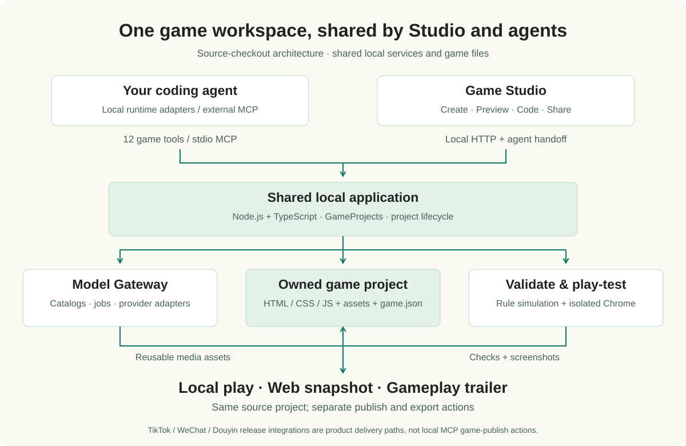</p>

| Layer | Responsibility | Source |
| --- | --- | --- |
| Game Studio | Brief, discovery, playable preview and source view | [GameStudio.tsx](studio/src/motion/game/GameStudio.tsx), [ArtifactBrowserPane.tsx](studio/src/super-agent/ArtifactBrowserPane.tsx) |
| Agent runtime | Client selection, conversation and task execution | [Runtime adapters](gateway/agent-runtimes.ts), [Super Agent](gateway/super-agent.ts), [29 clients](shared/local-agents.ts) |
| HTTP + MCP | Two entry points into shared game operations | [server.ts](server.ts), [mcp.ts](mcp.ts), [12 game tools](shared/game-tools.ts) |
| Game projects | Owned source, remixes, metadata and project lifecycle | [GameProjects](game-projects.ts), [game contract](shared/game-contract.ts) |
| Models + assets | Model catalogs, generation jobs and reusable media | [Model catalog](gateway/catalog.ts), [asset library](gateway/asset-library.ts) |
| Verification | Resource checks, rule simulation and browser play-tests | [Game service](game-projects.ts), [browser runtime](browser.ts), [game tests](tests/game-projects.test.ts) |
| Delivery | Local catalog, hosted web snapshots and gameplay trailers | [Web publishing](gateway/web-publish.ts), [delivery workflow](skills/openmotion-game/references/game-flow.md) |

### From a request to an owned game

1. **Choose a starting point.** A new brief creates a draft; remixing a bundled template creates an independent owned copy.
2. **Run the agent.** Game Studio hands the brief and game ID to the selected agent. An external client can instead use the game workflow through local MCP.
3. **Build and verify.** The agent changes the project files, brings in assets, checks resources and tests rules and input. Studio previews those same files.
4. **Deliver and continue.** Prepare a cover, a playable release or a trailer. Keep the local source for the next iteration; publish another snapshot when the shared version should change.

Owned games live in `MOTION_DATA_DIR/games/<game-id>/`, with `game.json`, the playable entry and supporting files. The workflow keeps plans, asset sources and verification evidence in `design/`. Bundled templates remain separate in `templates/games/`. Editing a ready or published game returns it to `building`.

### Technical stack

| Area | Stack | Why it is here |
| --- | --- | --- |
| Application services | Node.js + TypeScript | Shared game, agent and asset services for HTTP and MCP |
| Studio | React + Vite + Tailwind CSS + Zustand | A responsive workspace for creation, preview and project state |
| Game output | HTML, CSS, JavaScript; Canvas / WebGL / Three.js as needed | Editable browser games with a direct playable preview |
| Source inspection | [CodeViewer](studio/src/design/CodeViewer.tsx) | Read the actual game source alongside the result |
| Verification and video | Chrome + Hyperframes + FFmpeg / ffprobe | Browser evidence, gameplay capture and MP4 delivery |
| Interface system | Shared OpenDesign controls, fonts and brand assets | Consistent appearance across the workspace |

### Choose a layer to extend

| Build on OpenGame | Start here |
| --- | --- |
| Add a game or remix | [Game templates](templates/games), [game workflow](skills/openmotion-game/SKILL.md) |
| Improve the workspace | [Game Studio](studio/src/motion/game/GameStudio.tsx), [design system](packages/design-system/README.md) |
| Extend an agent integration | [Agent runtime architecture](docs/agent-runtime-architecture.md) |
| Add a model or asset workflow | [Model Gateway](docs/model-gateway.md), [assets](docs/assets.md) |
| Extend game tools or delivery | [Tool schemas](shared/game-tools.ts), [GameProjects](game-projects.ts), [contribution guide](CONTRIBUTING.md) |

[Architecture details, project layout and service boundaries →](docs/opengame-architecture.md) · [Installation & troubleshooting →](docs/opengame-setup.md)

<a id="launch-and-earn"></a>

## 🌍 Build for players. Launch for a business.

### TikTok, WeChat, Douyin — go where people play

Build once, then take your game to the platforms where players discover and play it. **Publish to TikTok, WeChat, Douyin and more**, with a version suited to each destination. Keep your editable source and keep improving after launch.

| Destination | Take your game to market |
| --- | --- |
| TikTok | Publish for players discovering games through TikTok and support the launch with gameplay content |
| WeChat | Release to the WeChat mini-game ecosystem and build an experience players can share and return to |
| Douyin | Release to the Douyin mini-game ecosystem and connect game discovery with playable experiences |
| The web | Share a playable link and let people try the game directly in a browser |

Use your developer account and complete the destination platform's release review. Keep a playable version, source and promotional material ready for each launch.

### Turn a fun loop into a commercial game

A game business starts with a player who wants another round. Shape the first session, test the challenge, make progress feel valuable and choose how the experience can support revenue.

| Business direction | Start with | Develop next |
| --- | --- | --- |
| Ad-supported mini-games | A short, replayable challenge with clear rewards | Retention, optional rewarded moments and the destination's ad integration |
| Paid content | A complete core experience | Additional levels, cosmetics or a premium edition, with payment integration |
| Brand games & playable ads | A product, campaign or character worth interacting with | A focused branded loop, end card and measurable call to action |

Choose the model that fits your players, then connect the relevant advertising or payment services. OpenGame makes commercial game creation accessible; your game, audience and ongoing operation create its revenue.

<a id="playable-ads"></a>

## 📱 Build a playable moment for your brand

A playable ad gives someone a short interaction before asking them to act. OpenGame's portrait workflow focuses on an immediate start, a brief tutorial, a compact challenge and a clear end card.

| Moment | Design goal | Example |
| --- | --- | --- |
| First interaction | Make the action obvious | Tap a pin, drag a ring, steer into a lane |
| Tutorial | Teach through the first move | Highlight one valid action and show its result |
| Challenge | Create a small, satisfying decision | Save the character or finish a short course |
| Feedback | Make success or failure legible | A clear reward, result and quick retry |
| End card | Connect the experience to the campaign | Brand, offer and a user-chosen call to action |

```text
Make a portrait coffee-shop playable ad based on Rooftop Roast.
Keep one simple delivery action, teach it with the first interaction,
and finish with a reward card for “Harbor Coffee”. Use supplied brand
assets, readable touch targets and a replay button. Keep the CTA URL
configurable. Do not publish until I review the playable result.
```

The output is an editable game. Choose the destination and its ad integration, then review the playable experience and campaign settings before submission.

<a id="verification"></a>

## 🧪 A game should survive being played

A page loading successfully is only the start. OpenGame separates file validation, game-rule simulation and browser interaction so an agent can find different kinds of failure.

| Check | What it establishes | What still needs attention |
| --- | --- | --- |
| Validate | Entry files, local references and supported source checks | Whether the game is enjoyable or balanced |
| Simulate | Deterministic rule behavior for games implementing the expected simulation contract | Visual feedback and real input behavior |
| Play-test | Scripted keyboard/mouse actions, state assertions, resource errors and layout checks | Physical touch, actual device performance and human play |
| Capture | A real frame from the running game | A complete run, sound quality or release acceptance |

The recommended verification plan includes a **reference strategy that can win**, a weak strategy that should fail and an idle path that should not silently succeed. For movement games, test meaningful displacement; for tap puzzles, use appropriate actions instead of claiming a movement test proves the puzzle works.

Keep the evidence with the game. If Chrome is unavailable, or touch/audio/performance was not checked, record that gap rather than turning an unrun check into a success.

<a id="sharing"></a>

## 🔗 From your workspace to someone else's browser

### Keep it locally, or publish a playable link

A finished game can be listed in the **local game catalog**. Public sharing is a separate action: with a signed-in OpenDesign account and a configured hosting workspace, web publishing bundles the game and referenced local assets into a static snapshot.

| Destination | What is delivered |
| --- | --- |
| Your workspace | Editable game files, metadata and source context |
| Local game catalog | A locally available playable entry |
| Public web publication | A shareable static snapshot through configured hosting |
| Gameplay trailer | Recorded gameplay assembled into an editable video project and MP4 |

Local edits do not automatically update a published snapshot. Publish again when you want the shared version to change, then verify that its assets load and controls work at the returned URL.

### Show the game in motion

The gameplay-trailer pipeline records game clips, assembles title/highlight/CTA sections and renders a video. It is useful for showing the game without asking everyone to launch it immediately. Chrome, FFmpeg/ffprobe and the prepared video runtime are required. Initial gameplay recording is silent; music, sound and final playback need their own review.

[Game sharing and trailer details →](skills/openmotion-game/references/game-flow.md)

<a id="faq"></a>

## 💬 Before your first build

<details>
<summary><strong>Do I need to code?</strong></summary>

You can start by describing a game and giving feedback in natural language. The agent writes the source. Knowing some web development helps with deeper customization, but the preview, templates and workflow provide concrete starting points for non-coders too. Review the game yourself before sharing it.

</details>

<details>
<summary><strong>Can I create 2D and 3D games?</strong></summary>

Yes. The bundled collection includes 2D and 3D browser games, and the workflow supports both. Choose a focused mechanic and target device; 3D assets, performance and input still need deliberate testing. Native console or app-store packaging is outside this browser-game workflow.

</details>

<details>
<summary><strong>Does it support multiplayer?</strong></summary>

New game creation currently uses the single-player workflow. Existing local room-based projects retain their local WebSocket server requirement. A static public share does not deploy that room server, so it should not be described as hosted multiplayer.

</details>

<details>
<summary><strong>Is everything free and offline?</strong></summary>

The original application code is open source. Browsing and playing locally bundled games does not require an agent. Agent services, generated media and optional hosting may require authentication, network access and payment. Individual game dependencies and third-party assets have their own terms.

</details>

<details>
<summary><strong>What stays editable?</strong></summary>

Your game's HTML, CSS, JavaScript and project documents remain in the workspace. Generated assets are referenced through the asset library. Public sharing produces a static snapshot; keep the local project as the source for later changes.

</details>

<a id="community"></a>

## 🤝 Build something people want to play

A useful contribution can be a tiny mechanic with great feel, a clearer tutorial, a reusable asset workflow or a reproducible bug report. Help the next creator begin with something better.

| Contribution | Include |
| --- | --- |
| A game or remix | Source, controls, a real screenshot, asset credits and how you tested it |
| A workflow improvement | The creation problem, proposed change and an example showing its effect |
| A bug report | Steps, expected/actual behavior, environment and relevant diagnostics |
| A Studio improvement | The user interaction, implementation and checks for affected layouts |
| Documentation or translation | Working commands, accurate examples and links that resolve |

Read [CONTRIBUTING.md](CONTRIBUTING.md) before opening a change. For source work, use the pinned Node version, preserve lockfiles and run checks for the affected boundary. Keep generated projects and credentials outside the checkout.

[Report an issue](https://github.com/OpenDesignHQ/opengame/issues) · [Contribute](CONTRIBUTING.md) · [Join Discord](https://discord.com/invite/M7NnHS9gNa) · [Follow OpenDesign](https://x.com/OpenDesignHQ)

**[Star OpenGame](https://github.com/OpenDesignHQ/opengame)** to follow new games and improvements. Share what you made, and the idea that made it fun.

## Acknowledgements

OpenGame is built by **OpenDesign** on the [OpenMotion](https://github.com/nexu-io/openmotion) codebase. Runtime identifiers and the source-build screenshots retain their existing labels. The README focuses on the game creation workflow of this repository.

The game workflow includes adapted guidance from [Higgsfield's skills](https://github.com/higgsfield-ai/skills); see the [provenance](skills/openmotion-game/PROVENANCE.md) and [MIT notice](skills/openmotion-game/LICENSE-HIGGSFIELD). The bundled video engine retains its [Hyperframes attribution](docs/hyperframes.md) and [Studio license](studio/LICENSE). Community references retain their original author credits in the catalog.

The hero combines a generated game-world background with an unaltered real Studio screenshot. Standalone game images are actual local captures; none of the background illustration is presented as game output. [Image sources and capture notes](docs/readme/opengame/ASSETS.md) · [Font notices](packages/design-system/fonts/NOTICES.txt)

[Apache-2.0](LICENSE) applies to this repository's original code. Third-party code, fonts and media retain their own terms.
