<p align="center"></p>

<p align="center"><strong>The Open-source Super Game Agent</strong><br>誰もが、収益を生むゲームを作れる世界へ。</p>

<p align="center">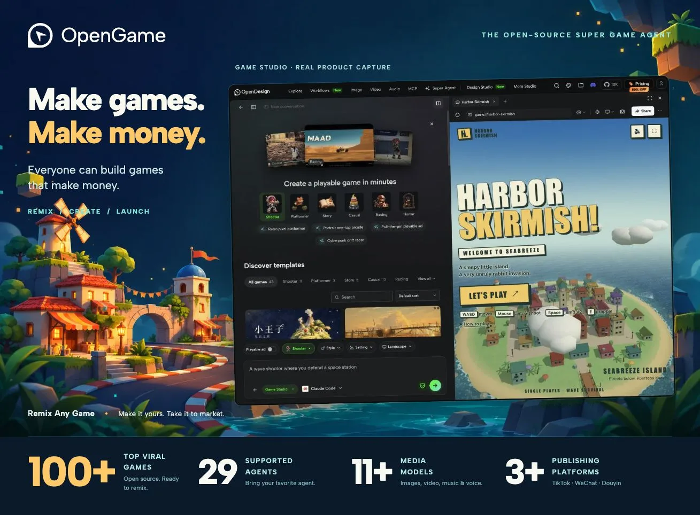</p>

<p align="center">
  <a href="https://github.com/OpenDesignHQ/opengame"></a>
  <a href="../package.json"></a>
  <a href="../LICENSE"></a>
  <a href="https://github.com/OpenDesignHQ"></a>
</p>

<p align="center">
  <a href="https://github.com/OpenDesignHQ/opengame"></a>
  <a href="https://go.open-design.ai/?utm_source=github&amp;utm_medium=referral&amp;utm_campaign=opengame&amp;utm_content=readme_ja"></a>
  <a href="https://discord.com/invite/M7NnHS9gNa"></a>
  <a href="https://applink.feishu.cn/client/chat/chatter/add_by_link?link_token=b6cs46dc-acb2-48ed-941d-c45642ead841"></a>
  <a href="https://x.com/OpenDesignHQ"></a>
  <a href="https://x.com/OpenDesignDevs"></a>
  <a href="https://www.youtube.com/channel/UChtshixMhvtgBWzoD9R_Qfg"></a>
</p>

<p align="center"><a href="#quick-start">導入</a> · <a href="#agent-wall">Agents</a> · <a href="#showcase">ゲーム・Remix</a> · <a href="#features">OpenGame を使う理由</a> · <a href="#technical-guide">設定・構成</a> · <a href="#community">コミュニティ</a></p>

<div align="center">

[English](../README.md) · [简体中文](README.zh-CN.md) · **日本語**

</div>

# OpenGame

OpenGame は **The Open-source Super Game Agent**。アイデアや好きなゲームを出発点に、Agent と仕組み、世界、報酬を作り込み、自分の遊べる作品へ育てるオープンソースのゲーム制作 Agent です。

**私たちの使命は、誰もが収益を生むゲームを作れるようにすること。**

アイデアと判断はあなたから。OpenGame は企画、Remix、アートと音、実装、試遊、公開準備をつなぎ、最初の一本からゲームビジネスへの道を支えます。

- 🎮 **Remix Any Game** ワンクリックで Remix を開始。参考作品や同梱ゲームの仕組みを、自分のテーマ、ルール、体験へ変えます。
- 🌍 **TikTok・WeChat・Douyin のプレイヤーへ** TikTok、WeChat、Douyin などへ公開。ひとつのアイデアを複数の市場へ届け、ゲームビジネスにつなげます。
- 🔥 **100+ TOP Viral Games** 商業的に実績のあるゲーム形式を集めた 100 本以上の人気ゲームを初公開。ソースを学び、実行し、自分の作品へ Remix できます。
- 🔑 **29 の Agent に対応。** 自分の Agent とモデルキーで、使い慣れた制作方法とソースを保持。[Agent を選ぶ](#choose-agent)。
- 🎨 **11+ メディアモデル。** ゲームのアート、音楽、声を制作。[モデルを見る](#model-wall)。

**Remix → 制作 → 試遊 → 公開 → 収益化。** 面白さを見つけ、自分の作品にし、また遊びたくなる理由を磨きましょう。

<a id="quick-start"></a>

## 🚀 まず遊んで、次に作る

### ソースから起動

Git、npm、CI 固定版の **Node.js 26.11.1** を用意してください。宣言されている最低実行バージョンは 22.18.0 です。

```sh
git -c filter.lfs.process= -c filter.lfs.smudge= -c filter.lfs.required=false clone --depth 1 --single-branch --branch main https://github.com/OpenDesignHQ/opengame.git
cd opengame
npm ci
npm run build:studio
```

macOS / Linux では、専用のワークスペースで起動します。

```sh
MOTION_DATA_DIR="$HOME/.opengame/workspace" npm start
```

起動結果の `previewUrl` を開き、**Game Studio**（`/game`）に進みます。同梱ゲームの閲覧と試遊は Agent 接続前でも可能です。制作や Remix では Agent を選び、変更したい内容を伝えます。統合 Studio の制作入口は、選択した Agent に直接タスクを渡す場合があります。

[Windows、手動 MCP 設定、トラブルシューティング →](opengame-setup.md)

### 最初の Remix

1. **面白さを探す。** ゲームを開いて操作し、残したい仕組みを一つ選びます。
2. **コピーを作る。** 同梱ゲームの **Remix** から、独立した編集可能な下書きを作ります。
3. **一つの変更を磨く。** テーマ、ルール、ステージなど、具体的な変更を Agent に伝えます。
4. **もう一度遊ぶ。** 結果を確かめ、手触りを調整してから共有します。

接続した Agent への最初の指示例：

```text
Drift Dash を月面バギーレースに Remix してください。
縦画面の操作を維持し、街を月面基地に変え、ドリフトで
チャージするブーストを追加してください。最初は同梱素材か
手続き型グラフィックスを使い、検証と試遊後に開いてください。
```

<a id="agent-wall"></a>

**29 のローカル Agent** · [Agent を選ぶ](#choose-agent)

<p align="center"><a href="#choose-agent"><picture><source media="(max-width: 600px)" srcset="readme/opengame/agents.mobile.webp">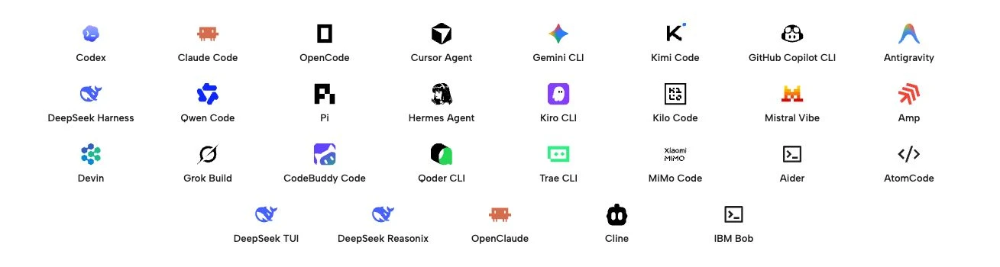</picture></a></p>

<a id="showcase"></a>

## 🔥 100+ TOP Viral Games を初公開。次はあなたの作品へ。

商業的に実績のある人気ゲームの形式を集めた **100+ TOP Viral Games コレクション**を、初めてオープンソースとして公開します。コアループを学び、ソースを実行し、世界観やルールを変えて自分のプレイヤーへ届けましょう。


以下の 6 例は、**このリポジトリに同梱されたゲームの実行画面**です。画像から編集可能なソースへ移動できます。試遊と Remix はローカルの Game Studio で行います。

<table><tr>
<td width="50%" valign="top">
<a href="../templates/games/harbor-skirmish">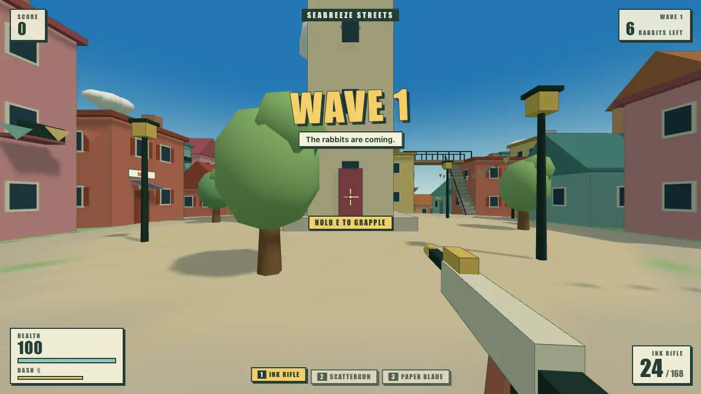</a><br>
<strong>Harbor Skirmish</strong><br>
<sub>3D アクション</sub><br>
海辺の島を走り、跳び、ダッシュやフックで移動。世界、敵、武器を変更できます。<br>
<a href="../templates/games/harbor-skirmish">ソースを見る</a>
</td>
<td width="50%" valign="top">
<a href="../templates/games/rooftop-roast">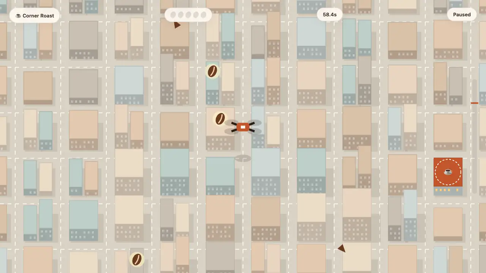</a><br>
<strong>Rooftop Roast</strong><br>
<sub>ブランド向けゲーム</sub><br>
ドローンでコーヒー豆を集め、カフェの屋上へ。店舗、キャンペーン、報酬をカスタマイズ。<br>
<a href="../templates/games/rooftop-roast">ソースを見る</a>
</td>
</tr>
</table>

<table>
<tr>
<td width="50%" valign="top">
<a href="../templates/games/drift-dash">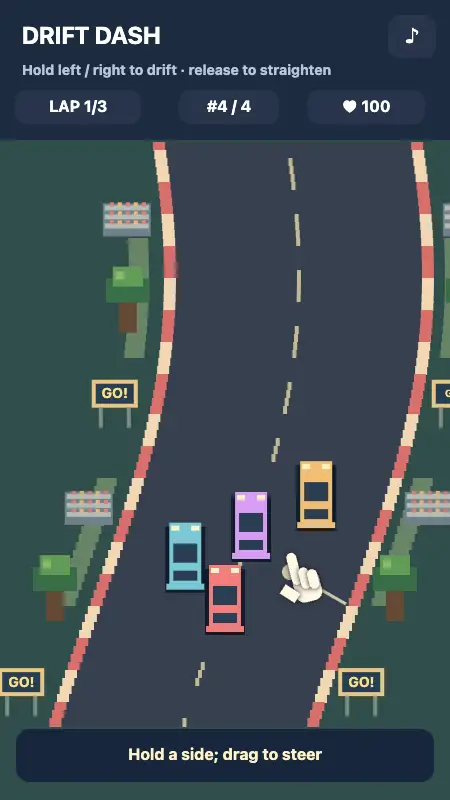</a><br>
<strong>Drift Dash</strong><br>
<sub>アーケードレース</sub><br>
3 周のコースで AI のライバル 3 台と競争。操作感、コース、勝利条件を変更。<br>
<a href="../templates/games/drift-dash">ソースを見る</a>
</td>
<td width="50%" valign="top">
<a href="../templates/games/pin-rescue">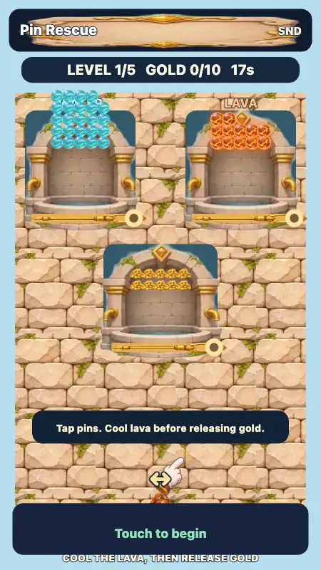</a><br>
<strong>Pin Rescue</strong><br>
<sub>パズル</sub><br>
ピンを抜いて水と溶岩を合わせ、金貨を取り出す。独自のステージを設計。<br>
<a href="../templates/games/pin-rescue">ソースを見る</a>
</td>
</tr>
</table>

<table>
<tr>
<td width="50%" valign="top">
<a href="../templates/games/sort-stack">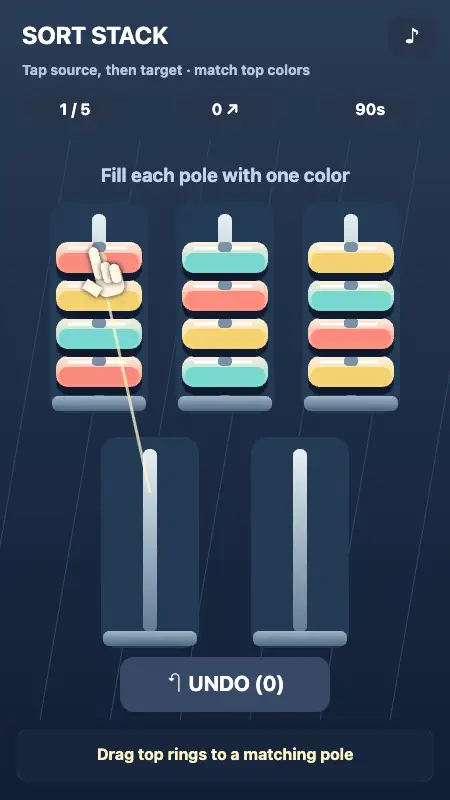</a><br>
<strong>Sort Stack</strong><br>
<sub>カジュアルパズル</sub><br>
同じ色のリングを柱の間で移動。色、配置、制限時間を調整。<br>
<a href="../templates/games/sort-stack">ソースを見る</a>
</td>
<td width="50%" valign="top">
<a href="../templates/games/tilt-temple">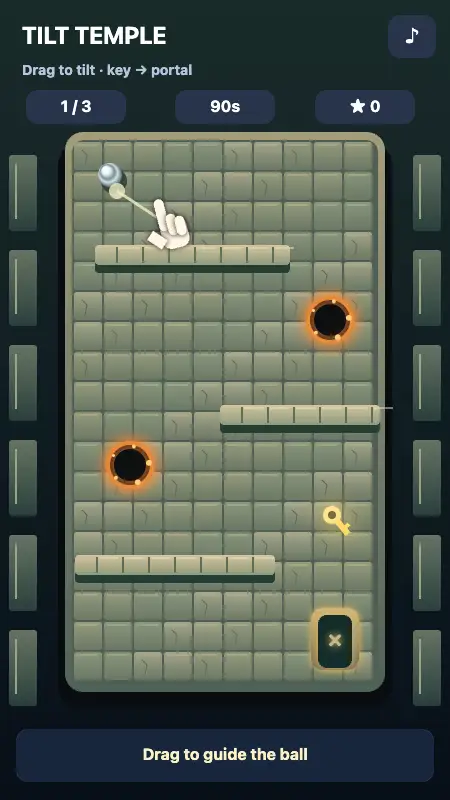</a><br>
<strong>Tilt Temple</strong><br>
<sub>物理チャレンジ</sub><br>
迷路を傾け、鍵を集めてポータルへ。道筋、障害物、雰囲気を変更。<br>
<a href="../templates/games/tilt-temple">ソースを見る</a>
</td>
</tr>
</table>

### コレクション全体を見る

以下のソース例は 6 ジャンルをカバーします。動くコアループから見た目、入力、ルールを変えられます。**このソーススナップショットには、コレクションのうち 26 本の同梱例が含まれます。**

| ジャンル | 同梱ゲーム |
| --- | --- |
| シューティング · 5 | [Comet Guard](../templates/games/comet-guard) · [Harbor Skirmish](../templates/games/harbor-skirmish) · [Lane Turret](../templates/games/lane-turret) · [Periscope Depth](../templates/games/periscope-depth) · [Starlight Bastion](../templates/games/starlight-bastion) |
| プラットフォーマー · 2 | [Lantern Hop](../templates/games/lantern-hop) · [Skyline Courier](../templates/games/skyline-courier) |
| 物語 · 2 | [Lighthouse Log](../templates/games/lighthouse-log) · [Night Train Letters](../templates/games/night-train) |
| カジュアル・パズル · 11 | [Castle Crush](../templates/games/castle-crush) · [Gate Legion](../templates/games/gate-legion) · [Glyph Garden](../templates/games/glyph-garden) · [Jingyang Ridge](../templates/games/jingyang-ridge) · [Merge Bakery](../templates/games/merge-bakery) · [Pin Rescue](../templates/games/pin-rescue) · [Rooftop Roast](../templates/games/rooftop-roast) · [Slime Swell](../templates/games/slime-swell) · [Sort Stack](../templates/games/sort-stack) · [Stack the Moon](../templates/games/stack-the-moon) · [Tilt Temple](../templates/games/tilt-temple) |
| レース · 4 | [Drift Dash](../templates/games/drift-dash) · [Neon Drift](../templates/games/neon-drift) · [Sky Runner](../templates/games/sky-runner) · [Tidebreaker](../templates/games/tidebreaker) |
| ホラー · 2 | [Hollow Signal](../templates/games/hollow-signal) · [Last Light](../templates/games/last-light) |

Studio には原作者へのリンクを持つコミュニティ参考作品も表示されます。同梱ソースとは別のコレクションです。外部参考の Remix は新しいオリジナルゲームのブリーフを作成し、作者のコードや素材を取り込むものではありません。

<a id="features"></a>

## ✨ OpenGame を使う理由

### 1. The Open-source Super Game Agent

<p>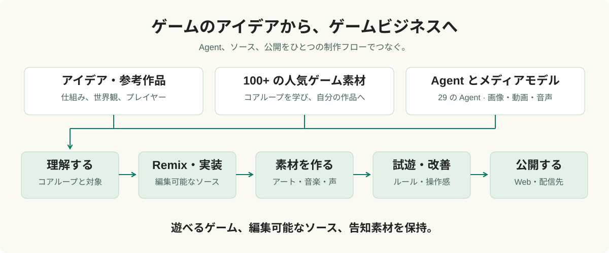</p>

#### Game Studio で制作・試遊・改善

左側でゲームを説明し、**Artifact Viewer** で結果を見て遊びます。プレビューとソースを切り替え、既存作品を開き直し、次の改良を Agent に伝えられます。何を変えるべきか、実物を見ながら判断できます。

<p>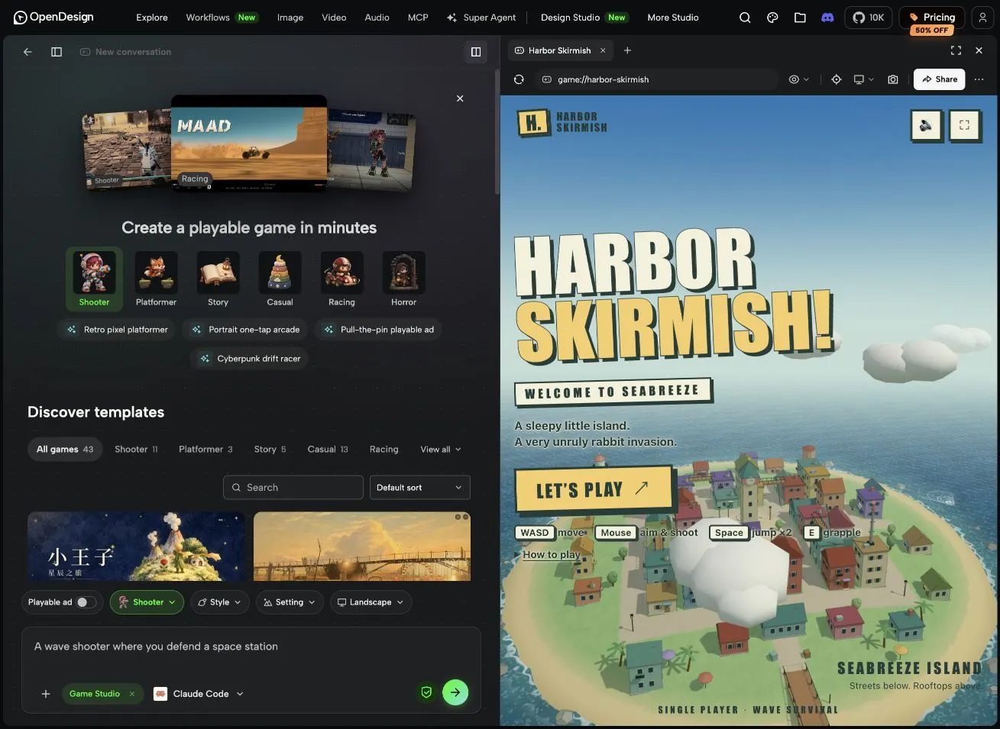</p>

*ソースから起動した実際の UI。同じワークスペースに制作画面と Harbor Skirmish を表示しています。*

| ワークスペースの機能 | できること |
| --- | --- |
| ジャンル・スタイル・設定 | 詳細なプロンプトを書く前に方向を決める |
| テンプレート検索 | 仕組みや表現に合う動く出発点を探す |
| プレイ可能なプレビュー | 操作、テンポ、フィードバックを実際に確認する |
| Preview / Code | 現在のゲームの HTML ソースを見る |
| 横画面 / 縦画面 | 端末と操作方法に合わせて設計する |
| 素材と所有ゲーム | 自分の下書きに戻り、制作を続ける |
| 共有・トレーラー | 必要な環境を整え、リンクや動画を用意する |

制作は **説明 → 実装 → 試遊 → 改良** の循環です。「最初のジャンプが難しい」「報酬を分かりやすく」「危険な道を選ぶ理由を作って」のような具体的な指示が役立ちます。

#### ブリーフから、遊べるゲームへ

明確な目標、反応のよい操作、続ける理由。ゲームワークフローは実装の前に、誰が遊び、何を行い、どう勝ち、どう失敗し、難度がどう変わるかを整理します。

<p>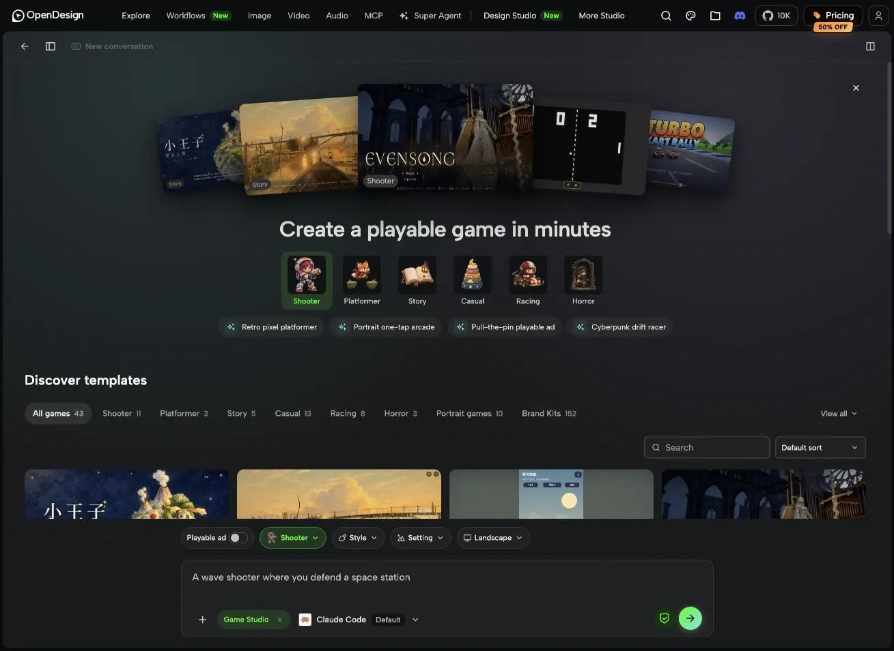</p>

ジャンルは **shooter、platformer、story、casual、racing、horror**。表現は **pixel、minimal、ASCII、voxel、anime、3D**。世界設定は **medieval、cyberpunk、retro、modern、space、fantasy**。これらはブリーフの方向づけであり、完成品には実装とレビューが必要です。

| 段階 | 作業 | 確認する成果 |
| --- | --- | --- |
| ブリーフ | 核となる操作、対象、端末、時間、成功条件 | 焦点の定まった体験の説明 |
| 計画 | 操作、カメラ、ルール、難度、視覚表現 | ゲーム計画とアート方針 |
| 素材 | 再利用、制作、生成 | 出典、ライセンス、費用を含む一覧 |
| 実装 | 仕組み、反応、メニュー、再開 | ゲームファイルと動くプレビュー |
| 検証 | リソース、ルール、入力のチェック | 実測結果、画面、残る課題 |
| 交付 | カバー、メタデータ、共有準備 | 再び開いて改善できる作品 |

```text
デスクトップ向けの、穏やかな屋上配達ゲームを作ってください。
90 秒で荷物を 3 個届けます。二段ジャンプと明確な着地点を用意し、
夕焼けの暖色と立体的な 3D 形状を使ってください。
最初の説明、タイマー、勝敗、ポーズ、再開を含め、最初の配達は
簡単にしてください。計画、実装、1 プレイ全体の検証まで行ってください。
```

<a id="choose-agent"></a>

### 2. 無料でオープンソース。自分の Agent とキーで。

**BYOA — Bring Your Own Agent。BYOK — Bring Your Own Keys。** ローカル Agent と自分のモデルサービスを選び、ゲームのソースを自分のワークスペースに保持します。

<p align="center">


</p>

**29 のローカル Agent で、同じゲーム制作フローを。** [対応一覧](#agent-wall)と[現在のクライアント定義](../shared/local-agents.ts)を確認できます。

OpenGame はゲームツール、ソース、見えるワークスペースをコーディング Agent に接続します。統合されたローカル Agent 入口、または**ローカル stdio MCP** 対応クライアントを使えます。ソースには上記クライアントのアダプター定義がありますが、インストール、認証、モデル対応は各クライアントに依存します。バッジは全組み合わせの検証済み表示ではありません。

| 用意するもの | OpenGame が提供するもの |
| --- | --- |
| インストール・認証済みのコーディング Agent | ゲーム作成、ファイル編集、プレビュー、検証ツール |
| アイデア、参考、テンプレート | ブリーフ、再利用可能な制作指針、編集可能なプロジェクト |
| 自分のアートや音楽、設定済みメディアサービス | 素材検索、生成ジョブ、共通の素材ライブラリ |
| クリエイティブな判断と試遊 | 繰り返せる検証、見える結果、保持できるソース |

オープンソースアプリにモデル利用枠は含まれません。Agent の契約、メディア生成、任意のホスティングにはそれぞれ条件があります。まず同梱素材と手続き型グラフィックスで遊びの核を作れます。

### 3. 100+ TOP Viral Games。Remix Any Game。

**好きなゲームから、自分の一本へ。** 仕組み、参考リンク、遊べる作品をブリーフにして、Agent にコアループの整理、世界観の変更、新しい成長や報酬、プレイ可能な実装を任せます。

同梱ゲームの **Remix** はソースを自分の下書きへコピーします。コミュニティ作品では、カタログの説明・ジャンル・スタイルから新しいオリジナル作品のブリーフを作ります。ワンクリックで制作を開始し、Agent が実装と試遊を進めます。外部作品のソースや素材は自動取り込みされません。

<p>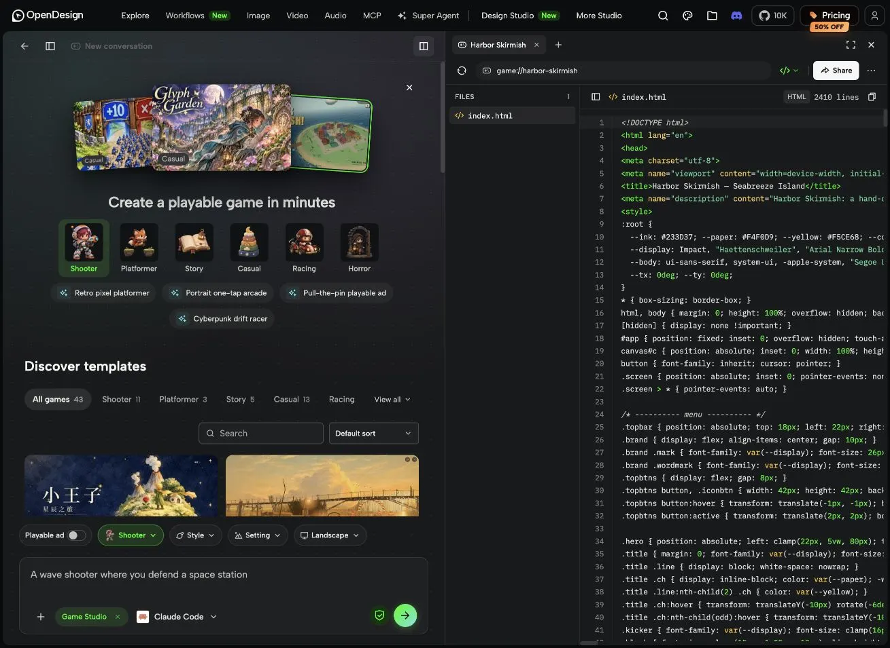</p>

*プレビューとソースは同じゲームの別の表示です。スクリーンショットの UI ラベルはそのまま保持しています。*

| 出発点 | Remix のアイデア |
| --- | --- |
| Harbor Skirmish | 敵を減らし、明確な目標を持つ時間制の救出ミッションへ |
| Drift Dash | ドリフトでブーストを充電し、コースを再設計 |
| Pin Rescue | 溶岩を水で冷やしてから金を落とす新しい問題へ |
| Sort Stack | 色名、取り消し、段階的な制約を持つ学習モードへ |
| Rooftop Roast | キャンペーン用に店舗、収集目標、報酬を変更 |
| Tilt Temple | 分岐、チェックポイント、異なるリスクと報酬を追加 |

これらは制作の提案で、完成した同梱バリエーションではありません。一つ変えて遊び、手応えが出てから広げましょう。

`design/plan.md` に体験と受け入れ条件、`design/assets.csv` に素材情報、`design/verification.md` に実際の検証と未確認点を残します。後日再開したり別の Agent に引き継いだりする際にも使えます。

#### ゲームと一緒に引き継ぐ制作コンテキスト

<p>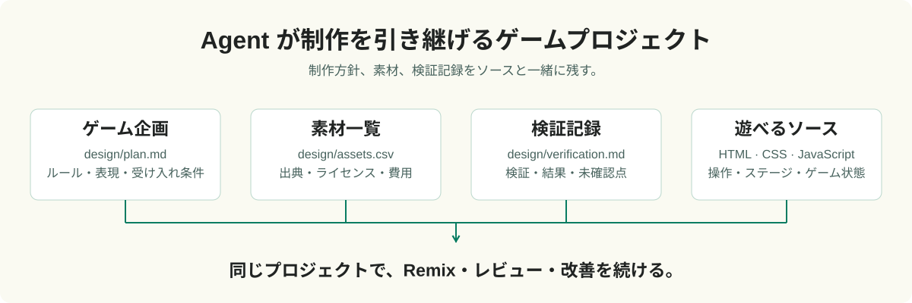</p>

### 4. ゲームの画像・動画・音楽・声を制作

<a id="model-wall"></a>

**11+ メディアモデル**で、画像・動画・音楽・音声を制作。接続済みサービスで利用できるモデルを使えます。

<p align="center">


</p>

既存素材を持ち込むか、設定済みサービスでキャラクター、背景、テクスチャ、音楽、音声、動画を生成します。Agent は現在のモデル一覧を確認し、適切な機能を選び、完成した素材をゲームに組み込みます。

| 必要な素材 | 現在の方法 | ワークフローのモデル例 |
| --- | --- | --- |
| キャラクター、環境、テクスチャ、カバー | 画像生成・持ち込み | GPT Image、Seedream |
| 音楽・雰囲気 | 音楽生成・持ち込み | ElevenLabs Music |
| ナレーション・台詞 | 音声合成・録音 | ElevenLabs、BytePlus TTS |
| シネマティック・告知素材 | 動画生成 | Wan、Seedance |
| 即時の効果音 | Web Audio で実装 | ローカル合成 |
| 3D キャラクター・小物 | 同梱 CC0 GLB・Three.js の手続き型形状 | 既存素材とコード |

正確なモデル ID と利用可否は接続環境の一覧に従います。全アカウントで全モデルが使えるという意味ではありません。専用の画像から 3D、リギング、アニメーション生成は、現在列挙されたゲーム向けモデル能力に含まれません。

まず既存素材で遊びを成立させ、生成する価値のある素材を選びます。出典、ライセンス、承認済み費用を記録することで、見栄えのよいゲームも保守しやすくなります。

<a id="technical-guide"></a>

## 🛠️ 設定と技術アーキテクチャ

### このソーススナップショット

上記の製品提供には、100 本以上のゲーム集と複数プラットフォームへの公開が含まれます。このガイドのチェックアウトには 26 本の同梱ゲームがあり、以下のコマンドとツール名はこの版に対応します。ゲーム公開ツールはローカル一覧への登録、Web 共有は独立したホスティング処理です。各プラットフォームへの公開には、対応する製品連携を使用してください。

### ソースと MCP

[セットアップガイド](opengame-setup.md)にはインストール、専用データディレクトリ、Windows、手動設定をまとめています。**Studio と MCP の絶対 `MOTION_DATA_DIR` を一致させること**が、同じゲームを見て編集するための条件です。

<details>
<summary><strong>stdio MCP の手動設定</strong></summary>

`mcpServers` オブジェクトを使うクライアント向けの例です。Node 実行ファイル、チェックアウト、ワークスペースを絶対パスに置き換えます。異なるクライアントでは固有の形式を使ってください。

```json
{
  "mcpServers": {
    "opengame": {
      "command": "/absolute/path/to/node",
      "args": [
        "--experimental-strip-types",
        "/absolute/path/to/opengame/mcp.ts"
      ],
      "env": {
        "MOTION_DATA_DIR": "/absolute/path/to/.opengame/workspace"
      }
    }
  }
}
```

ツールを再読み込みし、ゲームワークフローと指定したゲーム ID を読めるか確認します。Skill 指示だけではアプリや MCP 接続はインストールされません。クラウド専用クライアントはこのローカル stdio 設定を実行できません。

現在の識別子は `openmotion-game`、`openmotion://workflow/game/start`、`openmotion_game_*` です。このソース版では正確な名前を維持してください。設定内の `opengame` は接続の表示名です。

</details>

### ゲームツール

| 作業 | 現在のツール名 |
| --- | --- |
| 作成・確認 | `openmotion_game_create`、`openmotion_game_get` |
| ソースの読み書き | `openmotion_game_read_file`、`openmotion_game_write_files` |
| 表示情報 | `openmotion_game_update_meta`、`openmotion_game_capture_cover` |
| 動作検証 | `openmotion_game_validate`、`openmotion_game_simulate`、`openmotion_game_playtest` |
| 準備状態・ローカル公開 | `openmotion_game_set_status`、`openmotion_game_publish` |
| ゲーム動画 | `openmotion_game_trailer` |

Web 公開には素材ツールの `action: "web_publish"`、`targetKind: "game"` を使います。メディアの探索と生成も専用ツールを使い、実行前に現在のスキーマを確認します。

<a id="system-architecture"></a>

### OpenGame の仕組み

**Game Studio と Agent は同じゲームファイルを扱います。** UI は制作条件、プレビュー、ソース表示を担当し、Agent アダプターが制作タスクを実行します。共通サービスがゲーム、素材、検証を管理するため、同じプロジェクトを Studio でも外部 MCP クライアントでも継続できます。

<p>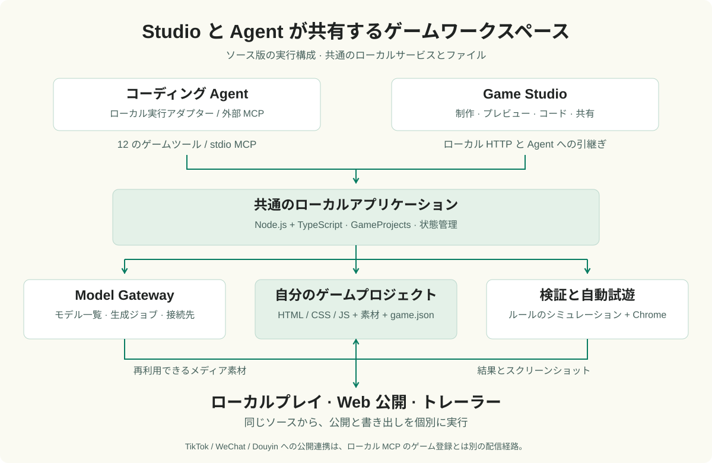</p>

| レイヤー | 役割 | ソース |
| --- | --- | --- |
| Game Studio | ブリーフ、探索、プレイ可能なプレビュー、ソース表示 | [GameStudio.tsx](../studio/src/motion/game/GameStudio.tsx)、[ArtifactBrowserPane.tsx](../studio/src/super-agent/ArtifactBrowserPane.tsx) |
| Agent 実行環境 | クライアント選択、会話、タスク実行 | [実行アダプター](../gateway/agent-runtimes.ts)、[Super Agent](../gateway/super-agent.ts)、[29 クライアント](../shared/local-agents.ts) |
| HTTP + MCP | 共通ゲーム操作への 2 つの入口 | [server.ts](../server.ts)、[mcp.ts](../mcp.ts)、[12 ゲームツール](../shared/game-tools.ts) |
| ゲームサービス | 所有ソース、Remix、メタデータ、状態管理 | [GameProjects](../game-projects.ts)、[ゲーム仕様](../shared/game-contract.ts) |
| モデルと素材 | モデル一覧、生成ジョブ、再利用できるメディア | [モデルカタログ](../gateway/catalog.ts)、[素材ライブラリ](../gateway/asset-library.ts) |
| 検証 | リソース検査、ルールのシミュレーション、ブラウザー試遊 | [ゲームサービス](../game-projects.ts)、[ブラウザー実行環境](../browser.ts)、[ゲームテスト](../tests/game-projects.test.ts) |
| 配信 | ローカル一覧、Web スナップショット、ゲームトレーラー | [Web 公開](../gateway/web-publish.ts)、[配信フロー](../skills/openmotion-game/references/game-flow.md) |

### リクエストから、自分のゲームへ

1. **出発点を選ぶ。** 新しいブリーフは下書きに、同梱テンプレートの Remix は独立した編集可能なコピーになります。
2. **Agent に渡す。** Studio がブリーフとゲーム ID を選択した Agent に渡します。外部クライアントはローカル MCP から同じゲームワークフローを利用できます。
3. **実装と検証。** Agent がファイルを変更し、素材を追加し、リソース・ルール・操作を検証。Studio はそのファイルをプレビューします。
4. **公開と改善。** カバー、プレイ可能な公開版、トレーラーを準備。ローカルソースを残して改善し、共有版を更新するときは再公開します。

所有ゲームは `MOTION_DATA_DIR/games/<game-id>/` に保存され、`game.json`、プレイ用エントリー、関連ファイルを含みます。制作方針、素材の出典、検証記録は `design/` に残し、同梱テンプレートは `templates/games/` に分離します。準備完了・公開済みのゲームを変更すると、状態は `building` に戻ります。

### 技術スタック

| 領域 | 技術 | 製品での役割 |
| --- | --- | --- |
| アプリケーションサービス | Node.js + TypeScript | HTTP と MCP でゲーム・Agent・素材サービスを共有 |
| Studio | React + Vite + Tailwind CSS + Zustand | 制作、プレビュー、プロジェクト状態を扱うワークスペース |
| ゲーム出力 | HTML、CSS、JavaScript；必要に応じ Canvas / WebGL / Three.js | ソースを編集して直接プレビューできるブラウザーゲーム |
| ソース表示 | [CodeViewer](../studio/src/design/CodeViewer.tsx) | 完成物と実際のソースを並べて確認 |
| 検証と動画 | Chrome + Hyperframes + FFmpeg / ffprobe | ブラウザー検証、プレイ録画、MP4 出力 |
| UI システム | OpenDesign の共通コントロール、フォント、ブランド素材 | ワークスペース全体で一貫した体験 |

### 拡張するレイヤーを選ぶ

| 作りたいもの | 開始点 |
| --- | --- |
| ゲームや Remix を追加 | [ゲームテンプレート](../templates/games)、[ゲームワークフロー](../skills/openmotion-game/SKILL.md) |
| ワークスペースを改善 | [Game Studio](../studio/src/motion/game/GameStudio.tsx)、[デザインシステム](../packages/design-system/README.md) |
| Agent 接続を拡張 | [Agent 実行環境の構成](agent-runtime-architecture.md) |
| モデル・素材フローを追加 | [Model Gateway](model-gateway.md)、[素材システム](assets.md) |
| ゲームツールや配信を拡張 | [ツール定義](../shared/game-tools.ts)、[GameProjects](../game-projects.ts)、[貢献ガイド](../CONTRIBUTING.md) |

[アーキテクチャ、プロジェクト構成、サービス境界の詳細 →](opengame-architecture.md) · [導入とトラブルシューティング →](opengame-setup.md)

<a id="launch-and-earn"></a>

## 🌍 遊べる作品から、ゲームビジネスへ

### TikTok・WeChat・Douyin — プレイヤーがいる場所へ

**TikTok、WeChat、Douyin などへの公開に対応。** ひとつのアイデアから配信先に合う版を用意し、プレイヤーが発見し、遊び、共有する場所へ届けます。ソースを保持し、公開後も改良を続けられます。

| 配信先 | 市場へ届ける方法 |
| --- | --- |
| TikTok | ゲームを公開し、プレイ紹介や告知コンテンツで新しいプレイヤーへ届ける |
| WeChat | ミニゲーム環境へ公開し、共有と継続プレイにつなげる |
| Douyin | ミニゲーム環境へ公開し、コンテンツ発見から実際のプレイへつなぐ |
| Web | プレイ可能なリンクを共有し、ブラウザーで直接試してもらう |

自分の開発者アカウントを使い、配信先の審査を完了してください。公開ごとにプレイ可能な版、ソース、告知素材を保持すると、その後の改善にも役立ちます。

### 面白いループを、収益につながる作品へ

もう一度遊びたいと思える体験が出発点です。最初の一回を分かりやすくし、挑戦、進行、報酬を磨いてから、作品に合うビジネスモデルを選びます。

| ビジネスの方向 | 出発点 | 次に磨くもの |
| --- | --- | --- |
| 広告付きミニゲーム | 短く、繰り返し遊べるチャレンジ | 継続率、任意の報酬タイミング、配信先の広告連携 |
| 有料コンテンツ | 完結した基本体験 | 追加ステージ、外観、上位版と決済連携 |
| ブランドゲーム・プレイアブル広告 | 商品、キャンペーン、キャラクター | ブランドに合う仕組み、終了画面、測定できる CTA |

プレイヤーに合うモデルを選び、必要な広告・決済サービスを接続してください。OpenGame は商用ゲーム制作の入口を広げ、収益は作品、プレイヤー、運営によって生まれます。

<a id="playable-ads"></a>

## 📱 ブランドを、短い遊びにする

プレイアブル広告では、行動を促す前に小さな体験を届けます。縦画面ワークフローは、すぐ遊べる開始、短い学習、コンパクトな挑戦、明確なエンドカードを重視します。

| 瞬間 | 設計の目的 | 例 |
| --- | --- | --- |
| 最初の操作 | 何をするか伝える | ピンを抜く、輪を動かす、車線を選ぶ |
| 学習 | 操作を通して教える | 最初の有効な操作と結果を示す |
| 挑戦 | 小さな満足を作る | 救出する、短いコースを終える |
| 反応 | 勝敗を明確にする | 報酬、結果、素早い再挑戦 |
| 終了 | キャンペーンにつなぐ | ブランド、特典、指定された CTA |

```text
Rooftop Roast から縦画面のコーヒー店広告を作ってください。
一つの配達操作を最初の体験で教え、最後に「Harbor Coffee」の
報酬カードを出します。提供されたブランド素材を使い、
押しやすい操作と再プレイを用意してください。CTA URL は設定可能にし、
公開はプレイ可能な結果のレビュー後にしてください。
```

出力は編集可能なゲームです。配信先と広告連携を選び、申請前にプレイ体験とキャンペーン設定を確認してください。

<a id="verification"></a>

## 🧪 実際のプレイに耐えるゲームへ

ページが開くだけでは十分ではありません。ファイル検証、ルールのシミュレーション、ブラウザー入力を分けて確認します。

| 検証 | 確認できること | 別途必要なこと |
| --- | --- | --- |
| Validate | 入口、ローカル参照、対応するソース検査 | 面白さとバランス |
| Simulate | 規定の契約を実装したゲームの決定的なルール動作 | 見た目と入力体験 |
| Play-test | キー・マウス操作、状態、リソースエラー、レイアウト | 実機タッチ、端末性能、人による試遊 |
| Capture | 実行中の実際の一場面 | クリア、音質、公開判定 |

推奨計画では、**適切な戦略で勝てること**、弱い戦略では失敗すること、放置で自動的に成功しないことを確認します。移動ゲームは有意な移動を、タップパズルは実際のパズル操作をテストします。

証拠を作品と一緒に残してください。Chrome がない場合や、タッチ、音、性能を調べていない場合は、その未確認点を明記します。

<a id="sharing"></a>

## 🔗 ワークスペースから、誰かのブラウザーへ

### ローカルに保存、またはプレイリンクを公開

完成したゲームは**ローカルのゲームカタログ**に登録できます。公開共有は別の操作です。OpenDesign にログインし、ホスティング用ワークスペースを設定すると、ゲームと参照するローカル素材を静的スナップショットとして公開できます。

| 送り先 | 成果物 |
| --- | --- |
| ワークスペース | 編集可能なファイル、メタデータ、制作の文脈 |
| ローカルカタログ | ローカルで遊べる作品 |
| 公開 Web | 設定済みホスティングによる静的スナップショット |
| トレーラー | ゲーム録画を使った編集可能な動画プロジェクトと MP4 |

ローカル編集は公開済みスナップショットに自動反映されません。更新時は再公開し、返された URL で素材と操作を確認します。

### 動画でゲームを伝える

トレーラー機能はゲーム映像を録画し、タイトル、見どころ、CTA を構成して動画にします。Chrome、FFmpeg/ffprobe、準備済みの動画ランタイムが必要です。初期録画は無音のため、音楽、効果音、最終再生は別途レビューします。

[共有・トレーラーの詳細 →](../skills/openmotion-game/references/game-flow.md)

<a id="faq"></a>

## 💬 制作前によくある質問

<details>
<summary><strong>コードを書く必要がありますか？</strong></summary>

自然言語でアイデアとフィードバックを伝え、Agent にソースを書かせるところから始められます。Web 開発の知識は深いカスタマイズに役立ちますが、テンプレートとプレビューは初心者にも具体的な出発点を提供します。共有前には自分でも遊んで確認してください。

</details>

<details>
<summary><strong>2D と 3D の両方を作れますか？</strong></summary>

はい。同梱作品と制作フローは両方に対応します。仕組みと端末を絞り、3D 素材、性能、入力を検証してください。ネイティブコンソールやアプリストア向けパッケージは別作業です。

</details>

<details>
<summary><strong>マルチプレイヤーに対応していますか？</strong></summary>

新規制作は現在シングルプレイヤーのフローです。既存のローカルルーム型ゲームにはローカル WebSocket サーバーが必要です。静的公開はそのサーバーを配備しないため、オンラインマルチプレイヤーのホスティングではありません。

</details>

<details>
<summary><strong>すべて無料でオフラインですか？</strong></summary>

アプリの独自コードはオープンソースで、同梱ゲームの閲覧と試遊に Agent は不要です。Agent、生成メディア、任意のホスティングは認証、通信、料金を必要とする場合があります。素材と依存関係にも固有の条件があります。

</details>

<details>
<summary><strong>何が編集可能なまま残りますか？</strong></summary>

HTML、CSS、JavaScript、制作文書はワークスペースに残り、生成素材は素材ライブラリから参照します。公開共有は静的スナップショットなので、後の変更用にローカルプロジェクトを保持してください。

</details>

<a id="community"></a>

## 🤝 遊びたくなるゲームを、一緒に

気持ちのよい小さな仕組み、分かりやすいチュートリアル、使い回せる素材フロー、再現できる不具合報告。どれも次のクリエイターの出発点を良くします。

| 貢献 | 添える情報 |
| --- | --- |
| ゲーム・Remix | ソース、操作、実際の画面、素材のクレジット、検証 |
| ワークフロー改善 | 問題、変更案、効果の分かる例 |
| 不具合 | 再現手順、期待値、実際の結果、環境、診断 |
| Studio 改善 | ユーザー操作、実装、影響するレイアウトの確認 |
| 文書・翻訳 | 動くコマンド、正確な例、有効なリンク |

変更前に [CONTRIBUTING.md](../CONTRIBUTING.md) を確認してください。固定 Node 版とロックファイルを使い、変更範囲に必要な検証を行います。生成プロジェクトと認証情報はチェックアウトの外に置きます。

[問題を報告](https://github.com/OpenDesignHQ/opengame/issues) · [貢献](../CONTRIBUTING.md) · [Discord](https://discord.com/invite/M7NnHS9gNa) · [OpenDesign をフォロー](https://x.com/OpenDesignHQ)

**[OpenGame に Star](https://github.com/OpenDesignHQ/opengame)** を付けて新しいゲームと改善を追ってください。作品と、それを面白くしたアイデアを共有しましょう。

## 謝辞

OpenGame は **OpenDesign** が [OpenMotion](https://github.com/nexu-io/openmotion) のコードベースから構築しています。ランタイム識別子と実際の UI スクリーンショットは既存の表記を保持しています。

ゲームワークフローには [Higgsfield skills](https://github.com/higgsfield-ai/skills) から適応した指針が含まれます。[出典](../skills/openmotion-game/PROVENANCE.md)と [MIT ライセンス](../skills/openmotion-game/LICENSE-HIGGSFIELD)を参照してください。[Hyperframes のクレジット](hyperframes.md)、[Studio のライセンス](../studio/LICENSE)、コミュニティ参考の原作者表示も保持しています。

ヒーローは生成したゲーム世界の背景と、描き直していない実際の Studio 画面を組み合わせています。個別ゲーム画像はローカル実行のキャプチャーです。背景イラストはゲーム出力ではありません。[画像の出典と撮影記録](readme/opengame/ASSETS.md) · [フォント通知](../packages/design-system/fonts/NOTICES.txt)

独自コードは [Apache-2.0](../LICENSE) です。第三者のコード、フォント、メディアには各自の条件が適用されます。
