<p align="center"></p>

<p align="center"><strong>The Open-source Super Game Agent</strong><br>人人都能做出能赚钱的游戏。</p>

<p align="center">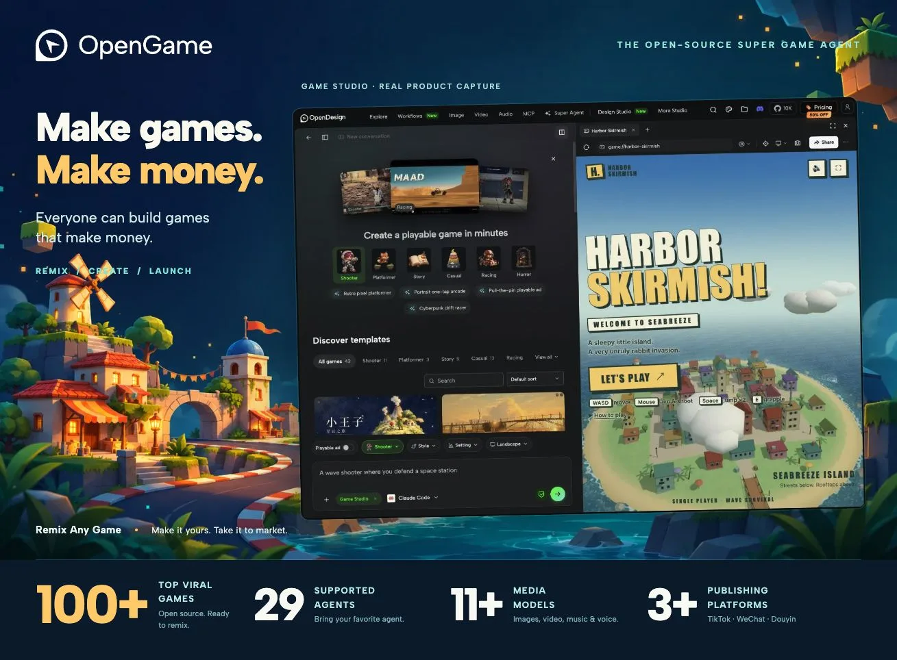</p>

<p align="center">
  <a href="https://github.com/OpenDesignHQ/opengame"></a>
  <a href="../package.json"></a>
  <a href="../LICENSE"></a>
  <a href="https://github.com/OpenDesignHQ"></a>
</p>

<p align="center">
  <a href="https://github.com/OpenDesignHQ/opengame"></a>
  <a href="https://go.open-design.ai/?utm_source=github&amp;utm_medium=referral&amp;utm_campaign=opengame&amp;utm_content=readme_zh"></a>
  <a href="https://discord.com/invite/M7NnHS9gNa"></a>
  <a href="https://applink.feishu.cn/client/chat/chatter/add_by_link?link_token=b6cs46dc-acb2-48ed-941d-c45642ead841"></a>
  <a href="https://x.com/OpenDesignHQ"></a>
  <a href="https://x.com/OpenDesignDevs"></a>
  <a href="https://www.youtube.com/channel/UChtshixMhvtgBWzoD9R_Qfg"></a>
</p>

<p align="center"><a href="#quick-start">快速开始</a> · <a href="#agent-wall">Agents</a> · <a href="#showcase">游戏与 Remix</a> · <a href="#features">为什么选择 OpenGame</a> · <a href="#technical-guide">配置与架构</a> · <a href="#community">社区</a></p>

<div align="center">

[English](../README.md) · **简体中文** · [日本語](README.ja.md)

</div>

# OpenGame

OpenGame 是 **The Open-source Super Game Agent**，一个从创意、复刻到游戏交付的开源超级游戏 Agent。带来一个想法，或一款喜欢的游戏，让 Agent 帮你拆解玩法、构建世界、打磨体验，做出自己的可玩作品。

**我们的使命：人人都能做出能赚钱的游戏。**

你提供创意和判断，OpenGame 串起游戏设计、玩法复刻、美术与声音、源码实现、试玩验证和发布准备。从第一款小游戏开始，走向自己的游戏生意。

- 🎮 **一键复刻任何游戏 · Remix Any Game** 从参考游戏或内置作品出发，把喜欢的核心玩法改成自己的主题、规则和体验。
- 🌍 **上架 TikTok、微信、抖音等平台** 支持上架 TikTok、微信、抖音等平台，让一个创意走向多个市场，把作品带到玩家面前。
- 🔥 **100+ TOP Viral Games 首次开源** 首次开放 100+ 款热门游戏，聚焦经过商业验证的玩法，让创作者可以直接研究、运行、复刻，做出自己的版本。
- 🔑 **支持 29 个 Agent。** 用自己的 Agent 和模型 Key，保留熟悉的工作方式与游戏源码。[选择 Agent](#choose-agent)。
- 🎨 **11+ 媒体模型。** 为游戏创作美术、音乐与语音。[查看模型](#model-wall)。

**找到玩法 → 一键 Remix → 做成自己的 → 试玩打磨 → 发行变现。** 从有趣出发，让玩家愿意开始，也愿意回来。

<a id="quick-start"></a>

## 🚀 先玩起来，再开始创作

### 从源码运行

准备 Git、npm 和 **Node.js 26.11.1**，这是 CI 固定使用的版本。项目声明的最低运行版本为 22.18.0。

```sh
git -c filter.lfs.process= -c filter.lfs.smudge= -c filter.lfs.required=false clone --depth 1 --single-branch --branch main https://github.com/OpenDesignHQ/opengame.git
cd opengame
npm ci
npm run build:studio
```

在 macOS / Linux 上使用独立工作目录启动：

```sh
MOTION_DATA_DIR="$HOME/.opengame/workspace" npm start
```

打开启动结果中的 `previewUrl`，进入 **Game Studio**（`/game`）。浏览和试玩内置游戏不需要先连接 Agent。需要创作或 Remix 时，再选择 Agent 并描述要做的改变；集成工作区中的创作入口可以把任务直接交给选中的 Agent。

[Windows 启动、手动 MCP 配置与排查指南 →](opengame-setup.md)

### 第一次 Remix

1. **找到有趣的部分。** 打开游戏，试试操作，决定要保留哪个核心机制。
2. **创建自己的副本。** 对内置游戏使用 **Remix**，获得独立的可编辑草稿。
3. **把一个变化做好。** 给 Agent 明确的主题、规则或关卡修改要求。
4. **重新玩一遍。** 验证效果、调整手感，准备好后再分享。

连接 Agent 后，可以这样开始：

```text
把 Drift Dash 改造成月球车竞速。保留竖屏操作，
把城市换成月球基地，并增加通过漂移充能的加速技能。
先使用内置素材或程序化图形。完成后验证、试玩，
再为我打开游戏。
```

<a id="agent-wall"></a>

**29 个本地 Agent** · [选择你的 Agent](#choose-agent)

<p align="center"><a href="#choose-agent"><picture><source media="(max-width: 600px)" srcset="readme/opengame/agents.mobile.webp">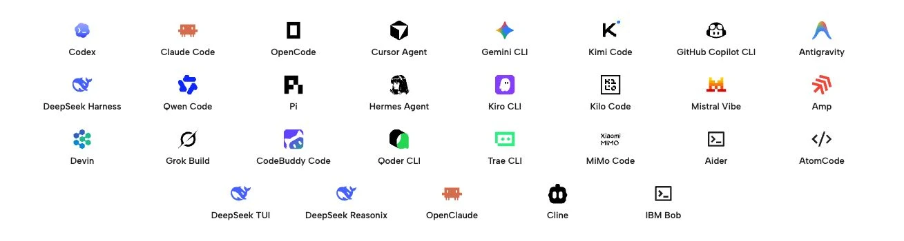</picture></a></p>

<a id="showcase"></a>

## 🔥 首次开源 100+ TOP Viral Games，让热门玩法成为你的起点

我们首次开放 **100+ TOP Viral Games 游戏库**，聚焦经过商业验证的热门玩法。研究核心循环、运行源码、改变主题与规则，再面向自己的受众做出新版本。从已经让人愿意玩的玩法出发，把创意投入到自己的差异化体验里。


下面六个示例均为**本仓库内置游戏的真实运行截图**。点击图片查看可编辑源码；在本地 Game Studio 中可以试玩和 Remix。

<table><tr>
<td width="50%" valign="top">
<a href="../templates/games/harbor-skirmish">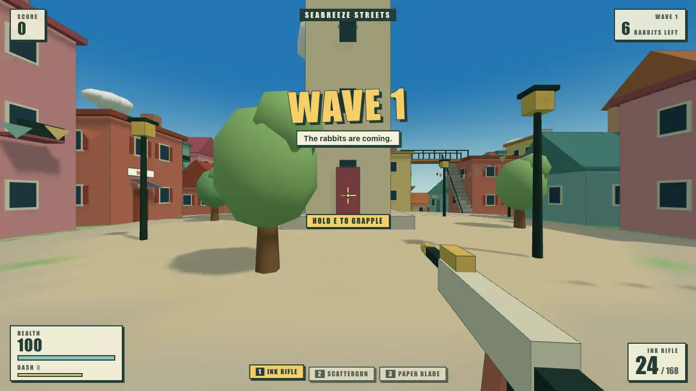</a><br>
<strong>Harbor Skirmish</strong><br>
<sub>3D 动作</sub><br>
在海港小岛奔跑、跳跃、冲刺和使用钩索。可以修改场景、敌人与武器。<br>
<a href="../templates/games/harbor-skirmish">查看源码</a>
</td>
<td width="50%" valign="top">
<a href="../templates/games/rooftop-roast">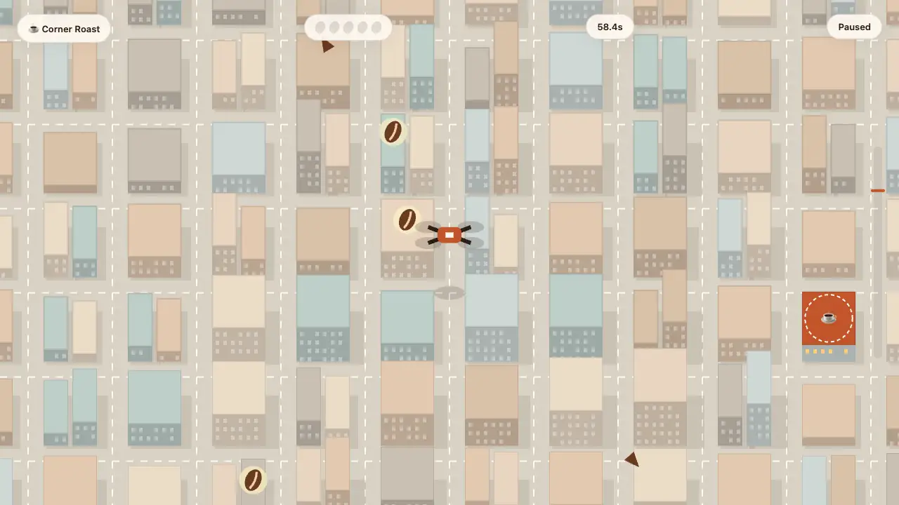</a><br>
<strong>Rooftop Roast</strong><br>
<sub>品牌小游戏</sub><br>
驾驶无人机收集咖啡豆，再降落到咖啡馆屋顶。将店铺、活动和奖励换成自己的。<br>
<a href="../templates/games/rooftop-roast">查看源码</a>
</td>
</tr>
</table>

<table>
<tr>
<td width="50%" valign="top">
<a href="../templates/games/drift-dash">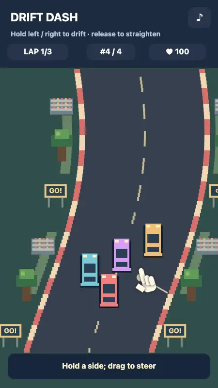</a><br>
<strong>Drift Dash</strong><br>
<sub>街机竞速</sub><br>
在三圈赛道中挑战三辆 AI 赛车。调整操控、赛道和获胜条件。<br>
<a href="../templates/games/drift-dash">查看源码</a>
</td>
<td width="50%" valign="top">
<a href="../templates/games/pin-rescue">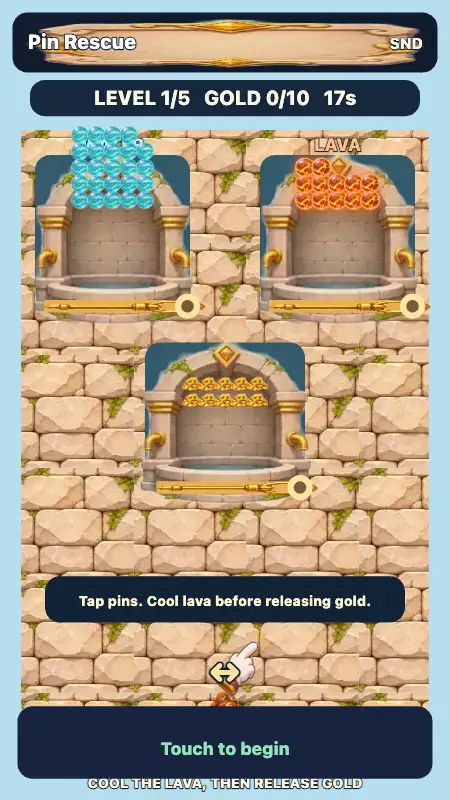</a><br>
<strong>Pin Rescue</strong><br>
<sub>拔针解谜</sub><br>
拔针让水与熔岩相遇，再释放金币。设计自己的关卡顺序。<br>
<a href="../templates/games/pin-rescue">查看源码</a>
</td>
</tr>
</table>

<table>
<tr>
<td width="50%" valign="top">
<a href="../templates/games/sort-stack">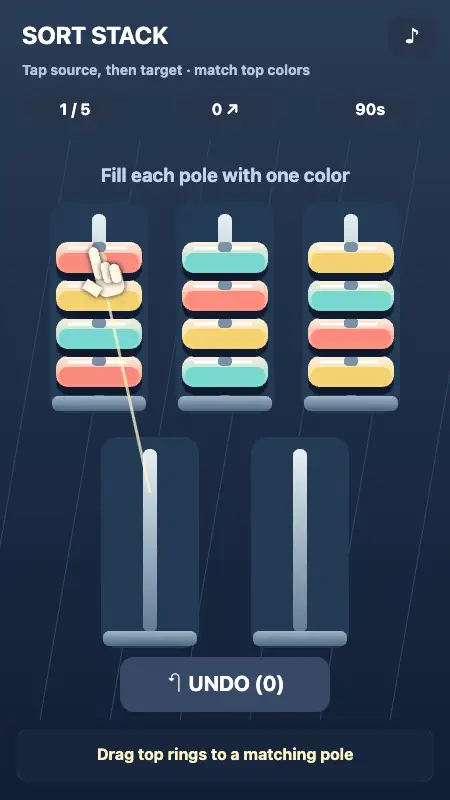</a><br>
<strong>Sort Stack</strong><br>
<sub>休闲解谜</sub><br>
在柱子之间移动同色圆环。修改配色、关卡布局和限时压力。<br>
<a href="../templates/games/sort-stack">查看源码</a>
</td>
<td width="50%" valign="top">
<a href="../templates/games/tilt-temple">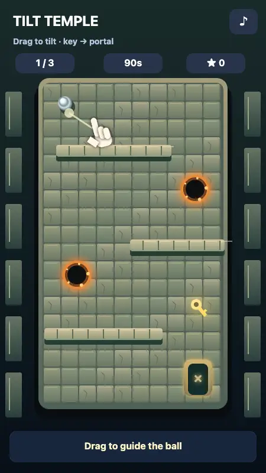</a><br>
<strong>Tilt Temple</strong><br>
<sub>物理挑战</sub><br>
倾斜迷宫、收集钥匙并抵达传送门。重新设计路线、机关与氛围。<br>
<a href="../templates/games/tilt-temple">查看源码</a>
</td>
</tr>
</table>

### 探索完整游戏库

以下源码示例覆盖六种类型，可以从已经运行的核心循环出发，尝试不同的美术、操作和规则。**这份源码快照包含完整游戏库中的 26 款内置示例。**

| 类型 | 内置游戏 |
| --- | --- |
| 射击 · 5 | [彗星守卫](../templates/games/comet-guard) · [海港突击](../templates/games/harbor-skirmish) · [星港三线炮台](../templates/games/lane-turret) · [潜望深渊](../templates/games/periscope-depth) · [星辉堡垒](../templates/games/starlight-bastion) |
| 平台跳跃 · 2 | [灯笼跳跃](../templates/games/lantern-hop) · [天际快递员](../templates/games/skyline-courier) |
| 叙事 · 2 | [灯塔手记](../templates/games/lighthouse-log) · [夜行列车的信](../templates/games/night-train) |
| 休闲与解谜 · 11 | [弹弓攻城](../templates/games/castle-crush) · [草原军团](../templates/games/gate-legion) · [符花庭园](../templates/games/glyph-garden) · [景阳冈](../templates/games/jingyang-ridge) · [合成小烘焙](../templates/games/merge-bakery) · [熔金拔针](../templates/games/pin-rescue) · [屋顶咖啡](../templates/games/rooftop-roast) · [史莱姆膨胀城](../templates/games/slime-swell) · [色环归位](../templates/games/sort-stack) · [叠叠月](../templates/games/stack-the-moon) · [倾斜神庙](../templates/games/tilt-temple) |
| 竞速 · 4 | [像素漂移冲刺](../templates/games/drift-dash) · [霓虹漂移](../templates/games/neon-drift) · [霓虹天际跑者](../templates/games/sky-runner) · [破潮者](../templates/games/tidebreaker) |
| 恐怖 · 2 | [空镇回声](../templates/games/hollow-signal) · [最后的光](../templates/games/last-light) |

Studio 还展示带原作者链接的社区参考作品。它们与仓库内置源码是两类内容：对外部参考使用 Remix，会建立一个新的原创游戏简报，不会导入原作者的代码或素材。

<a id="features"></a>

## ✨ 为什么选择 OpenGame

### 1. The Open-source Super Game Agent

<p>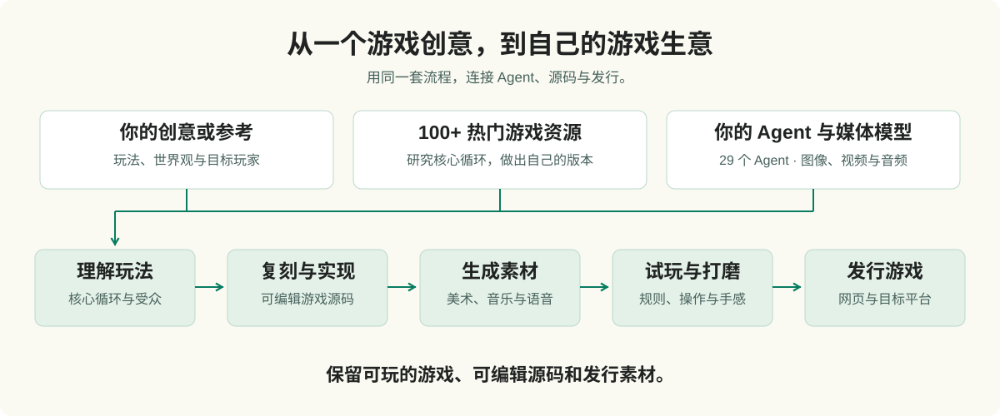</p>

#### 在 Game Studio 中创作、试玩、改进

在左侧描述游戏，在 **Artifact Viewer** 中查看与试玩结果。随时切换预览和源码，重新打开已有作品，或让 Agent 继续下一轮修改。边看、边玩、边决定接下来该改哪里。

<p>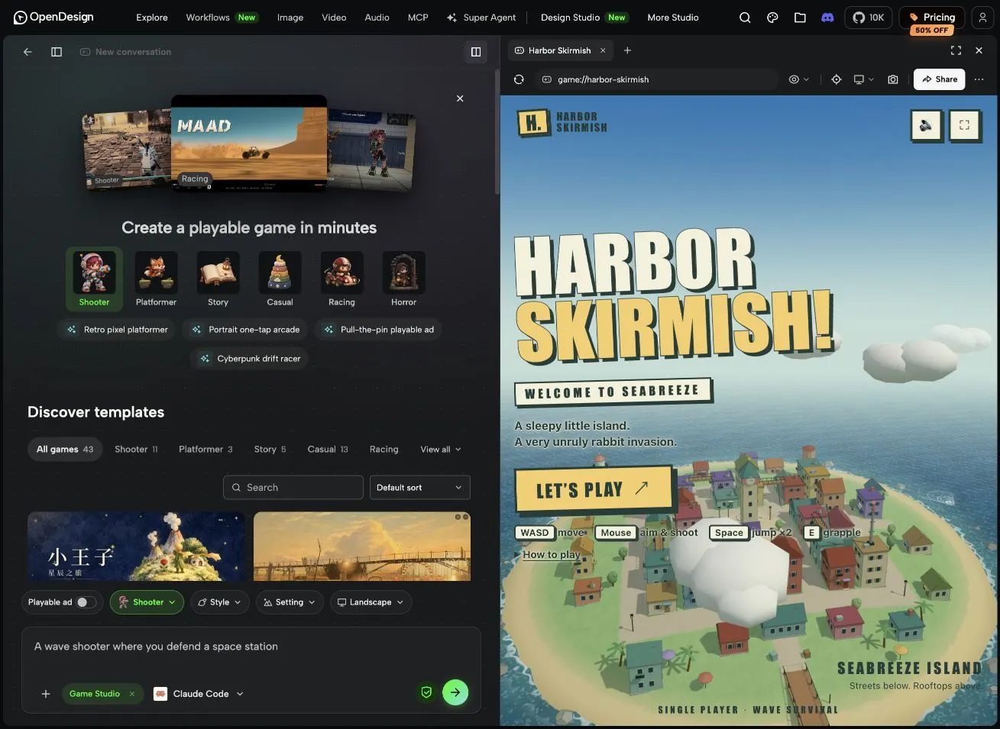</p>

*项目源码运行后的真实界面：Game Studio 与 Harbor Skirmish 在同一工作区展示。*

| 工作区能力 | 帮你完成什么 |
| --- | --- |
| 类型、风格与背景选择 | 在详细输入之前，先给 Agent 一个明确方向 |
| 模板发现与搜索 | 根据玩法或视觉想法，找到已经能运行的起点 |
| 可玩预览 | 实际操作游戏，观察节奏、反馈和难度 |
| Preview / Code 模式 | 查看当前游戏背后的 HTML 源码 |
| 横屏 / 竖屏 | 围绕目标设备和操作方式设计体验 |
| 素材库与自有游戏 | 返回自己的草稿，继续打磨已有作品 |
| 分享与预告片工具 | 在具备运行条件后，准备可玩链接或游戏视频 |

创作循环是：**描述 → 构建 → 试玩 → 改进**。有效的下一条指令往往很具体：“第一段跳跃太难了”“让奖励更明显”“给玩家一个走危险路线的理由”。

#### 从一句话，到可玩的作品

一个好玩的游戏需要清楚的目标、及时响应的操作，以及继续玩下去的理由。游戏工作流会先规划体验：谁来玩、做什么、如何获胜、如何失败，以及难度如何变化，然后再进入实现。

<p>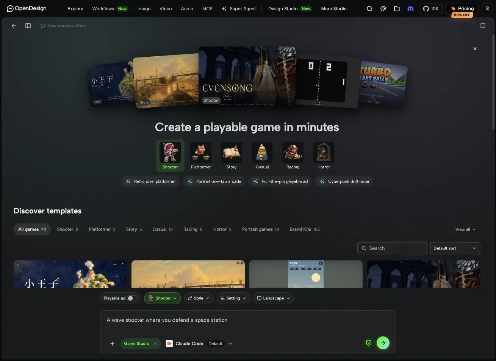</p>

选择**射击、平台跳跃、叙事、休闲、竞速或恐怖**；尝试**像素、极简、ASCII、体素、动漫或 3D**；把世界设定在**中世纪、赛博朋克、复古、现代、太空或奇幻**背景中。这些选项用于组织创作简报，最终游戏仍需实现和验收。

| 阶段 | 具体工作 | 可以检查的结果 |
| --- | --- | --- |
| 简报 | 核心动作、受众、设备、单局时长与成功条件 | 聚焦的体验描述 |
| 规划 | 操作、镜头、规则、难度与视觉公式 | 游戏方案和美术方向 |
| 素材 | 复用、制作或生成需要的视觉与音频 | 带来源、许可和成本的素材清单 |
| 实现 | 机制、反馈、菜单与重开逻辑 | 真实游戏文件与可玩预览 |
| 验证 | 检查资源、模拟规则、执行操作脚本 | 实测结果、截图和待验证项 |
| 交付 | 截取封面、保存信息、准备分享 | 可以重新打开和继续修改的作品 |

可以直接使用的简报：

```text
做一个面向桌面浏览器的温馨屋顶快递游戏。
玩家需要在 90 秒内送完三个包裹，有二段跳和清楚标出的落点。
使用暖色夕阳、块状 3D 造型。加入开场说明、可见倒计时、
成功与失败状态、暂停和重开。第一单要容易上手。
先完成规划，再实现，并测试完整的一局流程。
```

<a id="choose-agent"></a>

### 2. 免费开源，用你自己的 Agent 和模型

**BYOA — 用你自己的 Agent。BYOK — 用你自己的 API Key。** 选择本地 Agent，连接自己的模型服务，游戏源码始终保留在自己的工作区。

<p align="center">


</p>

**29 个本地 Agent，共用一套游戏创作流程。** [查看上方支持列表](#agent-wall)，或查看[当前客户端登记表](../shared/local-agents.ts)。

OpenGame 把游戏工具、源码和可视化工作区连接到编程 Agent。可以使用工作区的本地 Agent 入口，也可以连接支持**本地 stdio MCP** 的客户端。源码包含上面这些客户端的适配定义；具体安装、登录和模型能力取决于各客户端。图标展示不代表所有客户端与模型组合均已验证。

| 你带来 | OpenGame 提供 |
| --- | --- |
| 已安装、已登录的编程 Agent | 游戏创建、文件修改、预览与验证工具 |
| 一个创意、参考或起始模板 | 创作简报、可复用的工作流指引和可编辑项目 |
| 自己的美术、音乐或已配置的媒体服务 | 素材发现、生成任务和统一素材库 |
| 创意判断与实际试玩 | 可重复的检查、可见的结果和可以保留的源码 |

开源应用本身不包含模型额度。Agent 订阅、媒体生成和可选的托管服务分别有自己的使用条件。第一版可以先用内置素材和程序化图形，把核心玩法跑通。

### 3. 100+ TOP Viral Games，一键复刻任何游戏

**带来喜欢的游戏，做出自己的版本。** 从一个玩法、一条参考链接或一款可玩的作品出发，让 Agent 拆解核心循环，替换世界观、设计新的成长与奖励，再实现成可以操作的游戏。

内置游戏点击 **Remix** 后，会复制源码并创建自己的草稿。社区参考作品则根据目录中的描述、类型和风格发起新的原创游戏简报。一次点击启动流程，后续由 Agent 完成实现与试玩；外部游戏的源码和素材不会被自动导入。

<p>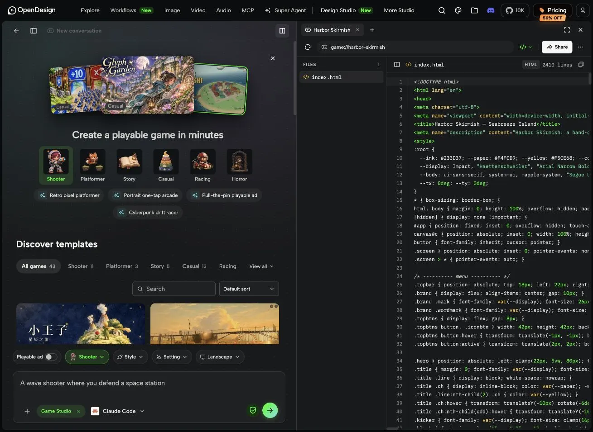</p>

*预览与源码对应同一个游戏。截图保留运行界面原本的名称与标签。*

| 起点 | 可以尝试的 Remix |
| --- | --- |
| Harbor Skirmish | 把波次生存改成限时营救，减少敌人并强化任务目标 |
| Drift Dash | 通过漂移给加速技能充能，重新设计赛道 |
| Pin Rescue | 增加必须先用水冷却熔岩、再让金币落下的谜题序列 |
| Sort Stack | 加入颜色文字标签、撤销，以及逐步提高约束的轻松教学模式 |
| Rooftop Roast | 为品牌活动更换店铺、收集目标与结束奖励 |
| Tilt Temple | 增加分岔路线、检查点和不同的风险回报 |

这些是可使用的创作方向，不代表上述变体已经作为成品内置。先改动一处、试玩，再扩展做得好的部分。

工作流将有用的上下文保存在普通项目文档中：`design/plan.md` 记录体验和验收条件，`design/assets.csv` 记录素材，`design/verification.md` 记录实际检查和缺口。以后继续开发，或交给另一个 Agent 时，可以直接接着这些材料工作。

#### 让创作上下文跟着游戏走

<p>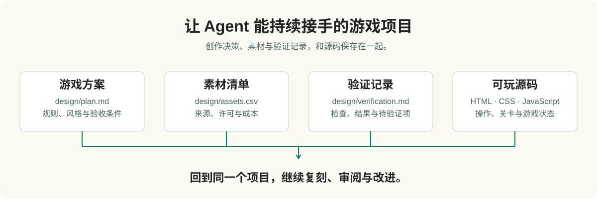</p>

### 4. 用图像、视频、音乐与语音，做出完整体验

<a id="model-wall"></a>

**11+ 媒体模型**，覆盖图像、视频、音乐和语音。使用已连接服务商提供的模型，完成游戏美术、声音与推广素材。

<p align="center">


</p>

带入已有素材，或者使用已配置的媒体服务生成角色、背景、纹理、音乐、语音和视频。Agent 先发现当前可用模型，选择合适能力，再将完成的素材放入游戏。美术方向贯穿整段体验。

| 创作需要 | 当前可用路径 | 工作流中的模型系列示例 |
| --- | --- | --- |
| 角色、场景、纹理、封面 | 图像生成或自带图片 | GPT Image、Seedream |
| 音乐与氛围 | 音乐生成或自带音频 | ElevenLabs Music |
| 旁白与角色台词 | 语音合成或自带录音 | ElevenLabs、BytePlus TTS |
| 过场或推广素材 | 视频生成 | Wan、Seedance |
| 即时操作音效 | 用 Web Audio 编写 | 本地合成，不调用媒体模型 |
| 3D 角色与道具 | 内置 CC0 GLB 或 Three.js 程序化几何体 | 现有 3D 素材与代码 |

具体模型 ID 和可用性以当前环境的模型目录为准；表格说明素材分工，不代表每个账号都有全部模型。当前列出的游戏模型能力不包含专门的图片转 3D、骨骼绑定或动画生成。

先用现有素材把玩法做出来，再决定哪些美术值得生成。素材清单记录来源、许可和批准的成本，让最终作品既好看，也方便继续维护。

<a id="technical-guide"></a>

## 🛠️ 配置与技术架构

### 这份源码快照

上文介绍的产品能力包含 100+ 游戏库和跨平台发行。这份安装指南对应的源码快照包含 26 款内置游戏；下方命令和工具名以该快照为准。游戏发布工具负责本地目录上架，公开网页分享使用独立托管流程；各平台发行操作请使用对应的产品接入流程。

### 源码与 MCP 配置

[安装指南](opengame-setup.md)涵盖源码安装、独立数据目录、Windows 和手动客户端配置。**Studio 和 MCP 必须使用同一个绝对 `MOTION_DATA_DIR` 路径**，这样 Agent 修改的才是工作区里看到的游戏。

<details>
<summary><strong>手动配置 stdio MCP</strong></summary>

下面适用于支持 `mcpServers` 对象的客户端。将路径替换为 Node 可执行文件、本仓库和工作目录的绝对路径。其他客户端请按其原生配置格式填写。

```json
{
  "mcpServers": {
    "opengame": {
      "command": "/absolute/path/to/node",
      "args": [
        "--experimental-strip-types",
        "/absolute/path/to/opengame/mcp.ts"
      ],
      "env": {
        "MOTION_DATA_DIR": "/absolute/path/to/.opengame/workspace"
      }
    }
  }
}
```

刷新工具发现，让 Agent 读取游戏工作流，并检查一个指定的游戏 ID。仅安装 Skill 指引不会安装应用，也不会建立 MCP 连接。纯云端客户端无法通过这份配置运行本地 stdio 进程。

当前实现中的准确名称是 `openmotion-game`、`openmotion://workflow/game/start` 和 `openmotion_game_*`。连接此源码版本时保留这些标识；配置中的 `opengame` 只是客户端显示的连接名称。

</details>

### 游戏工具集

| 任务 | 当前工具名称 |
| --- | --- |
| 创建与读取 | `openmotion_game_create`、`openmotion_game_get` |
| 查看与修改源码 | `openmotion_game_read_file`、`openmotion_game_write_files` |
| 更新展示信息 | `openmotion_game_update_meta`、`openmotion_game_capture_cover` |
| 验证行为 | `openmotion_game_validate`、`openmotion_game_simulate`、`openmotion_game_playtest` |
| 管理就绪状态与本地发布 | `openmotion_game_set_status`、`openmotion_game_publish` |
| 制作游戏视频 | `openmotion_game_trailer` |

公开网页发布使用独立的素材工具，参数为 `action: "web_publish"` 与 `targetKind: "game"`。媒体发现与生成由媒体和素材工具负责。调用前读取当前工具定义。

<a id="system-architecture"></a>

### OpenGame 如何运行

**Game Studio 和 Agent 操作同一份游戏文件。** 界面负责创作选项、预览和源码查看，Agent 适配层执行创作任务，共享服务管理游戏、素材与验证。同一个项目可以在 Studio 中继续，也可以交给外部 MCP 客户端。

<p>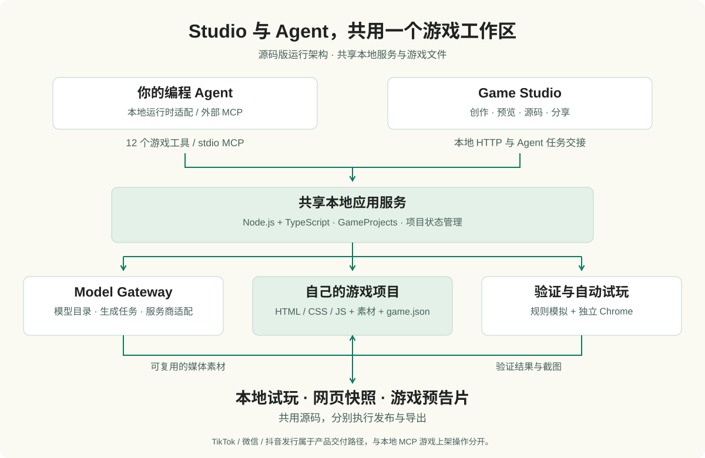</p>

| 架构层 | 负责什么 | 源码入口 |
| --- | --- | --- |
| Game Studio | 创作简报、发现、可玩预览与源码查看 | [GameStudio.tsx](../studio/src/motion/game/GameStudio.tsx)、[ArtifactBrowserPane.tsx](../studio/src/super-agent/ArtifactBrowserPane.tsx) |
| Agent 运行时 | 客户端选择、对话上下文与任务执行 | [运行时适配](../gateway/agent-runtimes.ts)、[Super Agent](../gateway/super-agent.ts)、[29 个客户端](../shared/local-agents.ts) |
| HTTP + MCP | 从两个入口调用共用的游戏操作 | [server.ts](../server.ts)、[mcp.ts](../mcp.ts)、[12 个游戏工具](../shared/game-tools.ts) |
| 游戏项目服务 | 自有源码、Remix、元数据与项目状态管理 | [GameProjects](../game-projects.ts)、[游戏数据约定](../shared/game-contract.ts) |
| 模型与素材 | 模型目录、生成任务与可复用媒体 | [模型目录](../gateway/catalog.ts)、[素材库](../gateway/asset-library.ts) |
| 验证层 | 资源检查、规则模拟与浏览器自动试玩 | [游戏服务](../game-projects.ts)、[浏览器运行时](../browser.ts)、[游戏测试](../tests/game-projects.test.ts) |
| 交付层 | 本地目录、托管网页快照与游戏预告片 | [网页发布](../gateway/web-publish.ts)、[交付工作流](../skills/openmotion-game/references/game-flow.md) |

### 一次创作请求如何变成自己的游戏

1. **选择起点。** 新创意建立草稿；对内置模板使用 Remix，得到独立、可编辑的副本。
2. **交给 Agent。** Game Studio 把简报和游戏 ID 交给选定 Agent；外部客户端也能通过本地 MCP 使用相同游戏工作流。
3. **实现与验证。** Agent 修改项目文件、加入素材、检查资源并测试规则与操作，Studio 预览的就是这些文件。
4. **交付与迭代。** 准备封面、可玩版本或预告片。保留本地源码继续修改，需要更新公开版本时再发布新快照。

自己的游戏保存在 `MOTION_DATA_DIR/games/<game-id>/`，包含 `game.json`、可玩入口及关联文件。工作流把方案、素材来源和验证记录保存在 `design/` 中；内置模板独立保存在 `templates/games/`。修改已经就绪或发布的游戏后，项目会回到 `building` 状态。

### 技术栈

| 部分 | 技术 | 在产品中的作用 |
| --- | --- | --- |
| 应用服务 | Node.js + TypeScript | HTTP 与 MCP 共用游戏、Agent 和素材服务 |
| Studio | React + Vite + Tailwind CSS + Zustand | 创作、预览与项目状态组成的可视化工作区 |
| 游戏产物 | HTML、CSS、JavaScript；按需使用 Canvas / WebGL / Three.js | 可编辑、可直接预览的浏览器游戏 |
| 源码查看 | [CodeViewer](../studio/src/design/CodeViewer.tsx) | 在游戏结果旁查看实际源码 |
| 验证与视频 | Chrome + Hyperframes + FFmpeg / ffprobe | 浏览器实测、游戏录制与 MP4 交付 |
| 界面系统 | OpenDesign 共用控件、字体与品牌资源 | 统一工作区各处的使用体验 |

### 从哪一层开始扩展

| 想做什么 | 从这里开始 |
| --- | --- |
| 增加游戏或 Remix | [游戏模板](../templates/games)、[游戏工作流](../skills/openmotion-game/SKILL.md) |
| 改进工作区 | [Game Studio](../studio/src/motion/game/GameStudio.tsx)、[设计系统](../packages/design-system/README.md) |
| 扩展 Agent 接入 | [Agent 运行时架构](agent-runtime-architecture.md) |
| 接入模型或素材流程 | [Model Gateway](model-gateway.md)、[素材系统](assets.md) |
| 扩展游戏工具或交付 | [工具定义](../shared/game-tools.ts)、[GameProjects](../game-projects.ts)、[贡献指南](../CONTRIBUTING.md) |

[架构详解、项目目录与服务边界 →](opengame-architecture.md) · [安装与排错 →](opengame-setup.md)

<a id="launch-and-earn"></a>

## 🌍 从做出游戏，到发行自己的游戏生意

### TikTok、微信、抖音：到玩家所在的平台

**支持上架 TikTok、微信、抖音等平台。** 从一个游戏创意出发，面向不同平台准备发行版本，让作品走到玩家发现、体验和传播游戏的地方。保留自己的源码，发布后继续改进。

| 目标平台 | 让作品走向市场 |
| --- | --- |
| TikTok | 上架游戏，配合玩法演示与推广内容触达新玩家 |
| 微信 | 进入微信小游戏生态，让作品能够被分享、持续游玩 |
| 抖音 | 进入抖音小游戏生态，把内容发现与游戏体验连接起来 |
| 网页 | 分享可玩链接，让玩家直接在浏览器中体验 |

使用自己的开发者账号，按目标平台要求完成审核。为每次发行保留可玩版本、源码和推广素材，方便上线后继续迭代。

### 把有趣的玩法，做成有商业价值的游戏

先让玩家愿意再来一局：第一局容易理解，挑战持续变化，成长与奖励清楚可见。在这个基础上，再选择适合游戏的商业模式。

| 商业方向 | 从什么开始 | 接下来打磨什么 |
| --- | --- | --- |
| 广告变现小游戏 | 短局、易上手、可重复游玩的核心循环 | 留存、可选激励时机，以及目标平台广告接入 |
| 付费内容 | 完整且有价值的基础体验 | 新关卡、外观或高级版本，并接入支付能力 |
| 品牌游戏与试玩广告 | 产品、营销活动或值得互动的角色 | 品牌玩法、结束卡片和可以衡量的行动入口 |

选择适合玩家的商业模式，再接入对应的广告或支付服务。OpenGame 降低商业游戏创作门槛；收入来自作品、玩家和持续运营。

<a id="playable-ads"></a>

## 📱 为品牌创造一个可玩的瞬间

试玩广告让用户先参与一次互动，再决定是否行动。OpenGame 的竖屏流程围绕即时开始、简短教学、紧凑挑战和清楚的结束卡片展开。

| 时刻 | 设计目标 | 示例 |
| --- | --- | --- |
| 第一次互动 | 让动作一眼可懂 | 拔出插销、拖动圆环、驶入车道 |
| 教学 | 用第一次操作教会玩家 | 标出一个有效动作，立即展示结果 |
| 挑战 | 提供一个小而有满足感的决策 | 救出角色或完成短赛道 |
| 反馈 | 让成功或失败明确可见 | 清楚的奖励、结果与快速重试 |
| 结束卡片 | 让体验连接到活动目标 | 品牌、优惠与用户指定的行动入口 |

```text
以 Rooftop Roast 为起点，做一个竖屏咖啡店试玩广告。
保留一个简单的配送动作，用第一次互动完成教学，
最后展示“Harbor Coffee”的奖励卡。使用提供的品牌素材，
保证触控目标清楚，加入重玩按钮。CTA 地址可以配置。
先让我验收可玩结果，再发布。
```

产出是可编辑的游戏。选择投放平台并完成对应广告接入，在提交前验收试玩体验与活动设置。

<a id="verification"></a>

## 🧪 游戏要经得起真正的操作

页面能打开只是起点。OpenGame 将文件验证、规则模拟和浏览器操作分开，让 Agent 能发现不同层面的失败。

| 检查 | 可以证明什么 | 仍需关注什么 |
| --- | --- | --- |
| Validate | 入口文件、本地引用与支持的源码检查 | 是否好玩、数值是否合理 |
| Simulate | 按约定实现模拟接口的游戏，其规则是否确定地工作 | 视觉反馈与真实输入体验 |
| Play-test | 键盘 / 鼠标脚本、状态断言、资源错误和布局检查 | 实体触控、实际设备性能与人工试玩 |
| Capture | 正在运行的游戏的一帧真实画面 | 完整通关、声音质量或发布验收 |

推荐的验证计划包含：**合理策略能够获胜**、较差策略应当失败、挂机路径不能悄悄自动成功。移动类游戏要检查有效位移；点击解谜则应使用对应操作，不能用移动测试代替谜题验证。

把证据与作品一起保存。如果缺少 Chrome，或者没有验证触控、声音或性能，就记录这些缺口，避免将未执行的检查写成成功。

<a id="sharing"></a>

## 🔗 从自己的工作区，走到别人的浏览器

### 保存在本地，或者发布可玩链接

完成的作品可以加入**本地游戏目录**。公开分享是独立动作：登录 OpenDesign 并配置托管工作区后，网页发布流程会将游戏及引用的本地素材打包成静态快照。

| 去向 | 交付内容 |
| --- | --- |
| 自己的工作区 | 可编辑游戏文件、元数据和创作上下文 |
| 本地游戏目录 | 在本地可访问、可玩的作品条目 |
| 公开网页 | 通过已配置托管服务发布的静态快照 |
| 游戏预告片 | 实录游戏片段组成的可编辑视频项目与 MP4 |

本地修改不会自动更新已经发布的快照。需要更新公开版本时再次发布，并在返回的真实地址上验证素材与操作。

### 用视频展示游戏

游戏预告片流程会录制片段，组织标题、亮点与行动入口，再渲染成视频。适合让观众先看到游戏是什么样，再决定是否打开试玩。该流程需要 Chrome、FFmpeg/ffprobe 和准备好的视频运行环境。初始游戏录制为静音，配乐、音效和最终播放需要单独检查。

[游戏分享与预告片说明 →](../skills/openmotion-game/references/game-flow.md)

<a id="faq"></a>

## 💬 开始前，你可能想知道

<details>
<summary><strong>需要会写代码吗？</strong></summary>

可以从描述游戏、用自然语言反馈开始，由 Agent 编写源码。掌握一些网页开发知识有助于深度定制；预览、模板和工作流也为不写代码的创作者提供了具体起点。分享前仍应亲自试玩和验收。

</details>

<details>
<summary><strong>2D 和 3D 都能做吗？</strong></summary>

可以。内置集合包含 2D 和 3D 浏览器游戏，工作流也支持两者。先明确一个核心机制与目标设备，再验证 3D 素材、性能与输入。原生主机平台或应用商店打包不属于这套浏览器游戏流程。

</details>

<details>
<summary><strong>支持多人游戏吗？</strong></summary>

新游戏创作目前使用单人流程。已有的本地房间项目仍依赖本地 WebSocket 服务。公开静态分享不会部署房间服务器，因此不能视作已托管的在线多人游戏。

</details>

<details>
<summary><strong>所有功能都免费、离线吗？</strong></summary>

应用原创代码开源，浏览和试玩本地内置游戏无需 Agent。Agent 服务、媒体生成与可选托管可能需要登录、网络和付费。具体游戏依赖和第三方素材分别遵循自己的条款。

</details>

<details>
<summary><strong>哪些内容可以继续编辑？</strong></summary>

游戏的 HTML、CSS、JavaScript 和项目文档保存在工作区，生成素材通过素材库引用。公开分享产出静态快照；保留本地项目，作为后续修改的源文件。

</details>

<a id="community"></a>

## 🤝 一起做出让人想玩的游戏

一个手感很好的小机制、更清楚的教学、可复用的素材流程，或者能够复现的错误报告，都是有价值的贡献。让下一位创作者从更好的起点开始。

| 贡献方向 | 建议附上 |
| --- | --- |
| 游戏或 Remix | 源码、操作方式、真实截图、素材署名与验证过程 |
| 工作流改进 | 创作中遇到的问题、方案与效果示例 |
| 错误报告 | 复现步骤、预期与实际行为、环境及相关诊断 |
| Studio 改进 | 用户操作、实现，以及受影响布局的检查 |
| 文档或翻译 | 可执行命令、准确示例与有效链接 |

提交变更前阅读 [CONTRIBUTING.md](../CONTRIBUTING.md)。源码开发使用固定 Node 版本，保留锁文件，按改动范围执行检查。生成项目和凭证保存在仓库之外。

[报告问题](https://github.com/OpenDesignHQ/opengame/issues) · [参与贡献](../CONTRIBUTING.md) · [加入 Discord](https://discord.com/invite/M7NnHS9gNa) · [关注 OpenDesign](https://x.com/OpenDesignHQ)

**[Star OpenGame](https://github.com/OpenDesignHQ/opengame)**，关注新游戏与后续改进。分享你的作品，也分享那个让它变得有趣的想法。

## 致谢

OpenGame 由 **OpenDesign** 基于 [OpenMotion](https://github.com/nexu-io/openmotion) 代码构建。运行时标识和源码版截图保留原有名称，本 README 聚焦本仓库的游戏创作流程。

游戏工作流包含从 [Higgsfield skills](https://github.com/higgsfield-ai/skills) 适配的指引，详见[来源说明](../skills/openmotion-game/PROVENANCE.md)与 [MIT 许可](../skills/openmotion-game/LICENSE-HIGGSFIELD)。内置视频引擎保留 [Hyperframes 署名](hyperframes.md)和 [Studio 许可](../studio/LICENSE)。社区参考作品在目录中保留原作者署名。

首图由生成的游戏世界背景与未经重绘的真实 Studio 截图组成。独立游戏图片来自本地实录，背景插画不作为游戏运行成果展示。[图片来源与截图说明](readme/opengame/ASSETS.md) · [字体声明](../packages/design-system/fonts/NOTICES.txt)

本仓库原创代码使用 [Apache-2.0](../LICENSE)。第三方代码、字体与媒体保留各自的使用条款。
